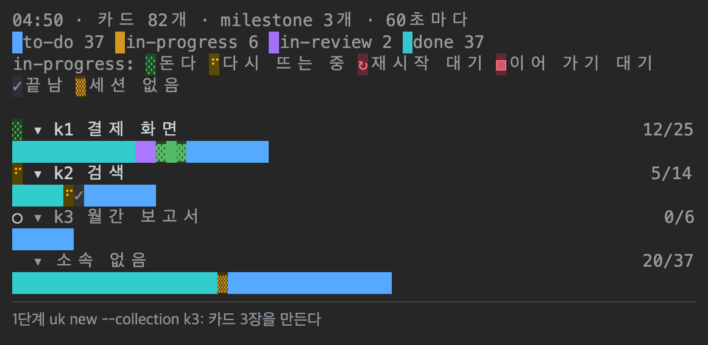
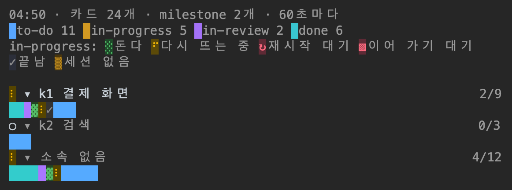
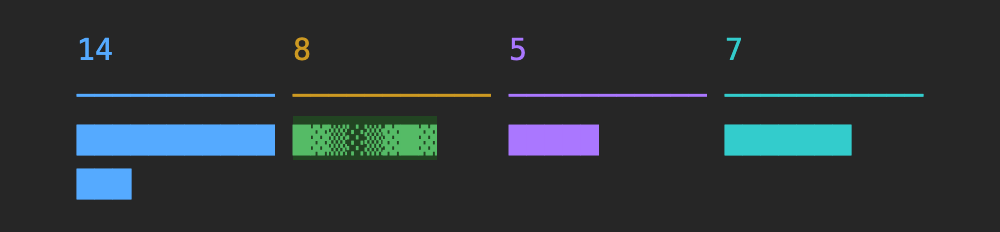
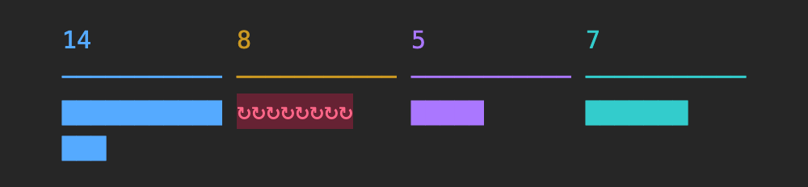
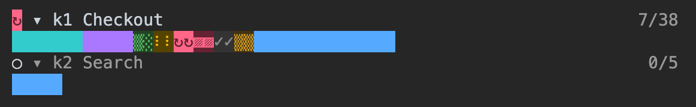
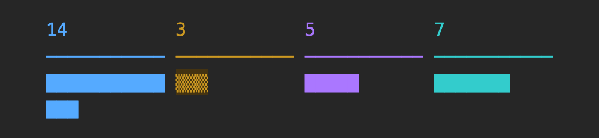
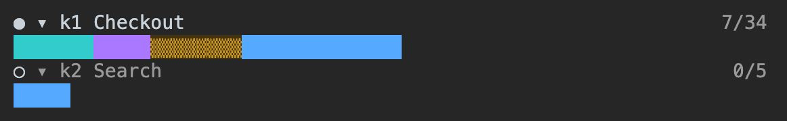
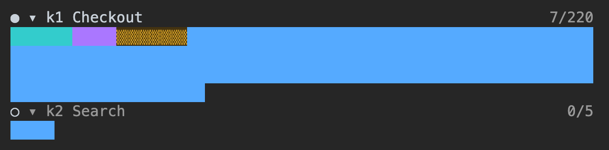
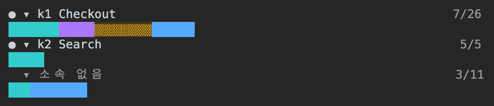

# uhd-kanban: Claude Code 용 마크다운 칸반 보드

[](plugins/uhd-kanban/LICENSE)
[](plugins/uhd-kanban/.claude-plugin/plugin.json)
[](https://github.com/anthropics/claude-code)
[](https://nodejs.org)

[English](README.md) | 한국어

**uhd-kanban** 은 프로젝트마다 칸반 보드를 `kanban/` 디렉터리의 마크다운 파일로 운영하는 Claude Code 플러그인이다. 메인 세션이 요청을 카드로 나누고, 카드마다 백그라운드 세션(`claude --bg`)을 하나씩 띄워 맡기고, 결과를 검토한다. Claude Code 의 pane 이 milestone 마다 소속 카드의 열과 카드 세션이 도는지를 보인다.

플러그인 말고는 설치하는 것이 없다. Docker · 서버 · 데이터베이스 · npm 패키지를 쓰지 않는다. 보드는 `uk check` 가 검사하는 정해진 형식의 마크다운 · JSON 파일이고, 명령은 Node.js 내장 모듈만 쓴다.



*가상의 카드로 만든 보드다. 시험용 `board` 출력으로 Claude Code 세션의 pane 을 캡처했고 카드 세션은 실행하지 않았다. 캡처용 사본은 보드를 1초마다 다시 읽게 고쳤다. pane 아래 줄은 단계를 적은 것이고 pane 의 일부가 아니다. pane 은 milestone 제목 · 카드 수 · 세션 상태를 보이고 작업 카드의 제목은 보이지 않는다.*

## 목차

- [uhd-kanban 의 기능](#uhd-kanban-의-기능)
- [플러그인 구성](#플러그인-구성)
- [빠른 시작](#빠른-시작)
- [언어](#언어)
- [보드 파일 배치](#보드-파일-배치)
- [카드 세션에 작업 맡기기](#카드-세션에-작업-맡기기)
- [명령](#명령)
- [보드 모니터 pane](#보드-모니터-pane)
- [필요한 것](#필요한-것)
- [사용 주의사항](#사용-주의사항)
- [자주 묻는 질문](#자주-묻는-질문)
- [출처](#출처)
- [라이선스](#라이선스)

## uhd-kanban 의 기능

| 기능 | 하는 일 |
|---|---|
| 일반 파일 | 카드 하나가 `.md` 파일 하나다. 열은 디렉터리 이름이, 열 안의 순서는 파일 이름 앞의 순서 번호가 갖는다. 그래서 `ls` · `git diff` · 아무 편집기로나 보드를 읽는다. Docker · 서버 · 데이터베이스 · 계정 · npm 패키지가 없다. 명령은 Node.js 내장 모듈(`node:fs` · `node:child_process` 등)만 import 한다. |
| 위임 | 메인 세션은 코드를 고치지 않는다. 카드마다 `claude --bg` 세션이 따로 돌고 그 세션은 카드 본문만 프롬프트로 받으므로, 메인 세션의 문맥에 구현 과정이 쌓이지 않는다. |
| 편집 확인 | 메인 세션이 Edit · Write · NotebookEdit 로 프로젝트 파일을 고치려 하면 훅이 사용자에게 확인 창을 띄운다. `bypassPermissions` 를 포함한 모든 권한 모드에서 뜬다. |
| 의존성 · 동시 실행 상한 | `depends_on` 에 적은 카드가 끝나기 전에는 카드를 시작하지 않는다. `run.max_parallel`(기본 3)이 동시에 도는 카드 세션 수를 제한한다. |
| 이어 가기 | `uk recover` 가 멈췄거나 데몬이 다시 띄운 카드 세션을 이어 가고 새 session id 를 카드에 적는다. |
| 보드 모니터 | pane 이 milestone 마다 행 하나를 그려 소속 카드 하나를 한 칸으로 그리고, in-progress 열의 칸을 세션 상태에 따라 애니메이션으로 그리며, 카드가 생성 · 삭제 · 이동되면 재배치를 재생한다. 행은 클릭이나 키보드로 접는다. 기본 갱신 주기는 60초다. |

## 플러그인 구성

| 구성 | 경로 | 하는 일 |
|---|---|---|
| 스킬 `uhd-kanban` | [`plugins/uhd-kanban/skills/uhd-kanban/`](plugins/uhd-kanban/skills/uhd-kanban/SKILL.md) | 카드 만들기 · 열 옮기기 · 순서 바꾸기 · 코멘트 · 아카이브. 카드를 `claude --bg` 세션으로 실행하기. 멈춘 세션 이어 가기 |
| 스킬 `delegate` | [`plugins/uhd-kanban/skills/delegate/`](plugins/uhd-kanban/skills/delegate/SKILL.md) | 보드가 있는 프로젝트의 메인 세션이 지킬 규칙. 작업을 카드로 나누고, `uk run` 으로 맡기고, 결과를 검토하고, 카드를 옮긴다 |
| hooks 모듈 | [`plugins/uhd-kanban/hooks/register.tsx`](plugins/uhd-kanban/hooks/register.tsx) | 세션 디렉터리 위에 `.uhd-kanban/config.json` 이 있으면 보드 모니터 pane 을 열고, `/kanban-board` 명령을 등록하고, Edit · Write · NotebookEdit 앞에서 `uk guard` 를 실행한다 |

## 빠른 시작

1. Claude Code 안에서 이 저장소의 마켓플레이스로 플러그인을 설치한다.

   ```
   /plugin marketplace add hwanyong/skill-kanban
   /plugin install uhd-kanban@skill-kanban
   ```

2. 프로젝트 루트에 보드를 만든다. Claude 에게 uhd-kanban 보드를 만들어 달라고 하거나 직접 실행한다.

   ```sh
   node ~/.claude/plugins/cache/skill-kanban/uhd-kanban/<버전>/skills/uhd-kanban/bin/uhd-kanban.mjs init --locale ko
   ```

   `.uhd-kanban/config.json` · `.uhd-kanban/profiles.json` · `kanban/` 이 생긴다. 이미 있으면 바꾸지 않고 종료 코드 1 로 끝난다.

3. 프로젝트 루트에서 `claude` 를 한 번 열어 workspace trust 대화 상자를 수락한다. `claude --bg` 는 상위 디렉터리의 trust 를 물려받지 않으므로, 수락하기 전에는 `uk run` 이 `Workspace not trusted` 로 실패한다.

4. 메인 세션에 작업을 맡긴다. `delegate` 스킬에 따라 메인 세션이 작업을 카드로 나누고 `uk run` 으로 띄운 뒤 카드 id · 결과 · 남은 결정을 보고한다.

내려받은 폴더로 설치하려면 `claude plugin marketplace add <폴더>` 뒤 `claude plugin install uhd-kanban@skill-kanban` 을 실행한다. 이때 Claude Code 는 그 폴더를 직접 읽으므로, 고친 뒤 `/reload-plugins` 로 다시 읽는다.

## 언어

보드마다 언어가 하나이고 `.uhd-kanban/config.json` 의 `locale`(`ko` · `en`)이 정한다. 명령 출력 · 카드 세션에 주는 프롬프트 · 보드 모니터 pane 의 글이 이 언어를 따른다. `uk init --locale ko|en` 이 이 값을 적는다. `--locale` 이 없으면 `init` 은 그때의 `LC_ALL` · `LC_MESSAGES` · `LANG` 으로 정한다(`ko` 로 시작하면 `ko`, 나머지는 `en`). `locale` 이 없는 보드는 실행할 때마다 그 변수를 따른다.

카드 파일에 적는 값은 언어와 무관하다. status · type · 코멘트 kind 는 `progress` · `question` · `result` 같은 영어 id 다. 한국어 보드는 kind 를 `progress(진행)` 처럼 보인다.

0.4.0 까지 만든 보드는 코멘트 kind 를 한국어 낱말로 적었다. `uk check` 가 이것을 알리고 `uk migrate` 가 바꾼다.

```sh
uk migrate --dry-run   # 바꿀 것을 출력한다
uk migrate             # comments.kinds 를 바꾸고 "locale": "ko" 를 넣고, 모든 카드의 코멘트 머리 줄을 바꾼다
```

바뀌는 것은 `### c<n> [<kind>]` 머리 줄과 `config.json` 의 두 줄뿐이다. 다시 실행하면 아무것도 바꾸지 않는다. `uk comment --kind` · `uk inbox --kind` 는 이전 한국어 낱말 14개(`lib/kinds.mjs`)도 받아 id 로 적으므로, migrate 전에 띄운 카드 세션도 그대로 동작한다.

## 보드 파일 배치

![uhd-kanban 이 보드를 저장하는 방식을 카드 24장인 데모 보드의 파일로 그린 그림. 왼쪽: sample-app 의 파일 트리. .uhd-kanban/config.json 은 locale · 열 9개 · run · archive · monitor 설정을, .uhd-kanban/profiles.json 은 model: 태그를 claude --model 값으로 바꾸는 표를 갖는다. kanban/ 아래 열 디렉터리는 1-to-do(카드 7장) · 2-in-progress(3장) · 3-in-review(2장) · 4-done(8장) · 5-decided(1장) · 7-implemented(1장) · 8-cancelled(1장) · 9-active(1장)다. 6-planned/ 는 없다. 열 디렉터리는 카드가 있는 동안만 있다. 오른쪽 위: 경로 kanban/2-in-progress/0030-k2-Add-login-form-validation.md 를 열 디렉터리 2-in-progress(status in-progress) · 열 안의 순서 0030 · 카드 id k2 · 제목 Add-login-form-validation 으로 나눴다. 오른쪽 아래: 그 파일 29줄. 1~13줄은 YAML frontmatter(id · type · title · priority · tags · depends_on · collection · created_at · updated_at · session · session_started_at)이고 uk 명령만 .uhd-kanban/lock/ 디렉터리를 잡은 채 파일 이름 · 디렉터리와 함께 바꾼다. collection 은 카드가 속한 milestone 의 id 목록이다. 15줄은 본문이고 uk run 이 카드 세션의 프롬프트에 넣는다. 17~29줄은 ## Comments 이고 블록 세 개가 있다. c1 [assign] 은 uk run 이 남긴 기록, c2 [question] 은 카드 세션의 질문, c3 [answer] 는 사용자의 답이다.](docs/images/board-storage.png)

*`uk` 명령으로 만든 데모 보드의 파일로 그린 그림. 트리와 파일 내용은 디스크의 파일 그대로이고, 보기 폭보다 긴 줄은 … 로 끝냈다. 카드 세션은 띄우지 않았다. `uk run` 은 세션 목록만 파일에 적는 `claude` 스텁(stub: 실제 프로그램 대신 정해진 값만 내는 스크립트)으로 실행했고, c2 · c3 은 `uk comment` 로 적었다.*

| 경로 | 내용 |
|---|---|
| `.uhd-kanban/config.json` | 열 · type 마다 처음 둘 열 · 순서 번호 · 의존성 규칙 · 코멘트 kind · 아카이브 규칙 · `run` 설정 · `monitor` 설정 |
| `.uhd-kanban/profiles.json` | `model:` 태그의 프로필 이름을 `claude --model` 값으로 바꾸는 표 |
| `kanban/<n>-<status>/<순서 번호>-k<id>-<제목>.md` | 열 안의 카드. 예: `kanban/1-to-do/0010-k457-로그인-오류-재현.md` |
| `kanban/archived/<YYYY-MM>/<YYYY-MM-DD>-k<id>-<제목>.md` | 아카이브한 카드. 날짜는 `completed_at` 의 날짜다 |

카드는 YAML frontmatter · 본문 · `## Comments` 절로 이루어진다. `uk run` 은 본문을 카드 세션의 프롬프트로 쓴다. `collection` 은 카드가 속한 milestone 의 id 목록이고 [보드 모니터 pane](#보드-모니터-pane) 의 행을 정한다.

```markdown
---
id: 457
type: task
title: 로그인 오류 재현
priority: high
tags: [model:deep, effort:high]
depends_on: [455]
collection: [450]
created_at: 2026-10-29T08:00:00Z
updated_at: 2026-10-29T09:10:00Z
---

목표 · 고칠 파일이나 범위 · 하지 않을 것 · 끝난 판정.

## Comments

### c1 [assign] from=user to=k457 at=2026-10-29T09:00:00Z

claude --bg 로 시작했다. session=… model=opus(model:deep) effort=high
```

frontmatter · 파일 이름 · 디렉터리는 명령으로만 바꾼다. 명령은 잠금(`.uhd-kanban/lock/` 디렉터리) 안에서 파일 이름과 frontmatter 를 함께 바꾼다. 카드 본문을 직접 고쳤으면 `uk check` 를 실행한다.

### `uk check` 가 검사하는 것

형식이 정해져 있으므로 카드 파일은 `uk check` 하나로 검사한다. 보드를 바꾸는 명령도 먼저 같은 검사를 하고, 규칙 위반이 있으면 아무것도 바꾸지 않는다.

| 대상 | 규칙 |
|---|---|
| 파일 이름 | `<순서 번호>-k<id>-<제목>.md`. 순서 번호는 `order.width` 자리(기본 4)이고 한 열 안에 한 번만 나온다 |
| 파일 이름과 frontmatter | `id` 가 파일 이름의 `k<id>` 와 같고, 파일 이름의 제목 부분이 `title` 과 같다 |
| 디렉터리 | `kanban/` 아래 디렉터리 · 파일은 모두 `config.json` 의 `columns` 에 있는 열이거나 `archive.dir`(기본 `archived/`)이다 |
| 열과 `type` | 카드의 `type` 이 그 열의 `types` 에 있다 |
| 카드 id | 카드 id 하나가 보드의 한 곳에만 있다 |
| frontmatter 값 | `title` 에 제어 문자가 없고, `priority` 는 정해진 값, `tags` 는 문자열 목록, `depends_on` · `collection` 은 카드 id 목록이다 |
| 코멘트 | `### c<n> [kind]` 의 kind 가 `config.json` 의 `comments.kinds` 에 있다 |

### 기본 열

| 디렉터리 | `status` | 둘 수 있는 type | 뜻 |
|---|---|---|---|
| `1-to-do` | `to-do` | task · bug · decision | 아직 시작하지 않은 일 |
| `2-in-progress` | `in-progress` | task · bug · decision | 카드 세션이 진행 중인 일 |
| `3-in-review` | `in-review` | task · bug | 구현을 마치고 검토를 기다리는 일 |
| `4-done` | `done` | task · bug · decision · milestone | 끝난 일 |
| `5-decided` | `decided` | decision | 결정했지만 아직 반영하지 않은 결정 |
| `6-planned` | `planned` | milestone | 계획만 있는 milestone |
| `7-implemented` | `implemented` | decision | 코드에 반영까지 끝난 결정 |
| `8-cancelled` | `cancelled` | task · bug · decision | 하지 않기로 한 일 |
| `9-active` | `active` | milestone | 진행 중인 milestone |

| type | 열의 차례 |
|---|---|
| task · bug | `to-do` → `in-progress` → `in-review` → `done`. 그만두면 `cancelled` |
| decision | `to-do` → `in-progress` → `decided` → `implemented`. 반영할 코드가 없으면 `done`, 정하지 않기로 하면 `cancelled` |
| milestone | `planned` → `active` → `done` |

## 카드 세션에 작업 맡기기

`uk run k457` 이 하는 일은 네 가지다.

1. 카드의 `model:<프로필>` 태그를 `profiles.json` 으로 `--model` 값으로 바꾸고, `effort:<값>` 태그를 `--effort` 로 넘긴다.
2. `uk move` 와 같은 의존성 검사를 거쳐 카드를 `run.status` 열(`in-progress`)로 옮긴다.
3. 프로젝트 루트에서 `claude --bg --dangerously-skip-permissions -n k457 --model … <프롬프트>` 를 실행한다. 프롬프트는 카드 본문 뒤에 `progress` · `question` · `result` 코멘트를 남기는 명령과 결과 뒤에 카드를 옮기는 명령을 붙인 것이다.
4. 카드에 `session` · `session_started_at` 을 적고 `assign` 코멘트를 남긴다.

카드 세션은 확인 창에 답할 사람이 없으므로 권한 확인 없이 돈다. 카드 세션은 모두 같은 작업 트리에서 돌기 때문에, 같은 파일 · 같은 생성물 · 같은 장치를 다루는 카드는 `depends_on` 으로 차례를 정한다.

| 태그 | `--model` |
|---|---|
| `model:top` | `fable` |
| `model:deep-1m` | `opus[1m]` |
| `model:deep` | `opus` |
| `model:standard` | `sonnet` |
| `model:fast` | `haiku` |
| `model:user` | 없음. 사람이 하는 카드이고 `uk run` 이 띄우지 않는다 |

카드 세션은 코멘트로 보고한다. `uk comment` 는 코멘트를 덧붙이고 받는 세션 앞으로 보낼 `SendMessage` 줄을 출력하고, `uk inbox` 는 그 세션 앞으로 온 코멘트 중 답하지 않은 것을 출력한다.

## 명령

스킬 문서에서 `uk` 는 `node <스킬 폴더>/bin/uhd-kanban.mjs` 를 줄여 적은 것이다. 대개 사용자가 직접 입력하지 않고 Claude 가 스킬에 따라 실행한다. 카드는 `k457` 또는 `457` 로 가리킨다.

| 명령 | 하는 일 |
|---|---|
| `uk init` | `.uhd-kanban/` 과 `kanban/` 을 만든다. `--locale ko\|en` 이 보드의 언어를 정한다 |
| `uk check` | 설정과 모든 카드를 검증한다. 파일은 바꾸지 않는다 |
| `uk new` | 카드를 만든다 |
| `uk move` | 의존성을 검사하고 카드를 다른 열로 옮긴다 |
| `uk order` | 같은 열 안에서 카드의 자리를 바꾼다 |
| `uk renumber` | 한 열의 순서 번호를 다시 매긴다 |
| `uk set` | 제목 · 우선순위 · 태그 · `depends_on` · `collection` 을 바꾼다 |
| `uk archive` | 끝난 뒤 `archive.after_days`(기본 7)일이 지난 카드를 `kanban/archived/` 로 옮긴다 |
| `uk comment` | 코멘트를 덧붙이고 `SendMessage` 줄을 출력한다 |
| `uk inbox` | 한 세션 앞으로 온 코멘트 중 답하지 않은 것을 출력한다 |
| `uk run` | 카드를 `claude --bg` 세션으로 띄운다 |
| `uk recover` | 멈춘 카드 세션을 `claude --bg --resume` 으로 이어 간다 |
| `uk guard` | 그 세션이 그 파일을 고쳐도 되는지 판정한다(훅이 쓴다) |
| `uk board` | 열마다 카드 수, 세션 상태, milestone 마다 끝난 수 / 전체 수를 출력한다(pane 이 쓴다) |
| `uk migrate` | 0.4.0 까지 만든 보드의 kind 를 영어 id 로 바꾸고 `locale` 을 넣는다 |
| `uk locale` | 지금 디렉터리에서 쓸 언어를 출력한다(pane 이 쓴다) |

종료 코드는 `0` 성공 · `1` 규칙 위반이나 실행 실패(내용은 stderr) · `2` 사용법 오류 · `3` 부른 디렉터리 위에 보드가 없음이다. 전체 옵션은 [`SKILL.md`](plugins/uhd-kanban/skills/uhd-kanban/SKILL.md#명령) 에 있다.

[보드 파일 배치](#보드-파일-배치) 그림의 데모 보드에서 `locale` 을 `ko` 로 바꿔 `uk board` 를 실행한 출력:

```
1-to-do 7개
2-in-progress 3개 (세션: none 2 · resume 1)
3-in-review 2개
4-done 8개
5-decided 1개
7-implemented 1개
8-cancelled 1개
k1 v1.0 release (active) 7/17
소속 없음 4/6
```

수는 작업 카드만 센다. `6-planned` · `9-active` 는 milestone 만 받는 열이라 나오지 않는다. 이 보드의 k2 는 세션을 실제로 띄우지 않았으므로 판정이 `resume` 이다.

## 보드 모니터 pane


*가상의 작업 카드 24장으로 만든 시험용 `board` 출력을 캡처했다. 세션 상태를 여러 가지 보이려고 만든 출력이고, [보드 파일 배치](#보드-파일-배치) 의 데모 보드와는 다른 보드다.*

pane 은 세션 디렉터리 위에 `.uhd-kanban/config.json` 이 있으면 열린다. 닫힌 pane 은 `/kanban-board` 로 다시 연다. 맨 위 줄은 시각 · 작업 카드 수 · 끝나지 않은 milestone 수 · 갱신 주기이고, 그 아래는 열의 색과 세션 상태의 범례다. 그 아래에 끝나지 않은 milestone 마다 행 하나(swimlane: 소속으로 묶은 가로 행)가 있고, `collection` 이 빈 카드는 마지막 `소속 없음` 행에 든다. 행의 차례는 `active` milestone → `planned` milestone → `소속 없음` 이다.

| 행의 부분 | 보이는 것 |
|---|---|
| 머리 줄 기호 | `active` 는 `●`, `planned` 는 `○`. 소속 카드의 세션 상태가 `restart` · `pending` · `live` · `resume` 중 하나이면 이 차례로 앞선 상태의 글자로 바뀐다 |
| 접기 기호 | `▾` 는 막대를 펼친 행, `▸` 는 접은 행이다 |
| 제목 | `k<id>` 와 milestone 제목. `planned` 는 흐리게 그린다. 작업 카드의 제목은 보이지 않는다 |
| 오른쪽 수 | 끝난 카드 수 / 소속 카드 수. 아카이브한 카드를 포함해 센다. 끝난 카드는 `dependencies.resolved` 와 `dependencies.abandoned` 의 열에 있는 카드다 |
| 막대 | 소속 작업 카드 하나가 한 칸이고 pane 폭에서 줄을 바꾼다. 칸의 색은 카드의 열이고, 왼쪽부터 끝난 열(`done` · `decided` · `implemented` · `cancelled`) → `in-review` → `in-progress` → `to-do` 차례다 |

- milestone 의 소속은 작업 카드의 `collection` 이다. 여러 milestone 에 속한 카드는 행마다 칸이 있다.
- `done` 으로 옮긴 milestone 은 행을 그리지 않는다. 그 소속 카드는 어느 행에도 들지 않고 맨 위 범례의 열별 카드 수에는 남는다.
- 머리 줄의 `▾ k<id>` 를 클릭하면 그 행의 막대를 접고, 다시 클릭하면 편다. 키보드로는 `ctrl+x tab` 으로 pane 에 포커스를 옮긴 뒤 `Tab` 으로 고르고 `Enter` 로 누른다. 접어도 머리 줄 기호의 애니메이션과 오른쪽 수는 그대로다. 접은 행의 목록은 세션 디렉터리마다 저장되어 세션을 다시 시작해도 유지된다.
- 작업 카드가 `run.status` 의 열로 옮겨지면 `uk move` · `uk run` · `uk recover` 가 그 카드가 속한 `planned` milestone 을 `active` 로 함께 옮긴다. 그 밖의 어긋남(`planned` 인데 `in-progress` 소속 카드가 있다, `active` 인데 소속 카드가 모두 끝났다)은 `uk check` 가 stderr 로 알리고 옮기지 않는다.

| in-progress 칸 | 범례 | 세션 상태 | 다시 그리는 간격 |
|---|---|---|---|
| 초록 `░▒▓█▓▒`. 카드마다 한 글자씩 어긋난다 | `돈다` | `live`: 실행 중이다 | 250 ms |
| 노랑 `⠋⠙⠸⠴⠦⠇` | `다시 뜨는 중` | `pending`: 데몬이 세션을 다시 띄우는 중이다 | 250 ms |
| 빨강 `↻`. 글자색과 배경색이 프레임마다 바뀐다 | `재시작 대기` | `restart`: 다시 뜬 세션이 idle 이고 마지막 차례가 사용자다. `uk recover` 가 stop 한 뒤 이어 간다 | 250 ms |
| 빨강 `▨` | `이어 가기 대기` | `resume`: 세션이 멈췄다. `uk recover` 로 이어 간다 | - |
| 회색 `✓` | `끝남` | `done`: 끝났다 | - |
| 열의 색 `▒` | `세션 없음` | `none`: 카드에 세션이 없다 | - |

갱신 주기는 `config.json` 의 `monitor.interval_seconds` 다(10 이상의 정수, 기본 60). 0.8.0 에서 `monitor.cell` 키를 없앴다. 기존 `config.json` 에 남아 있으면 오류 없이 무시한다.

pane 높이에 들어가지 않는 행은 스크롤한다. `uk board` 는 소속을 읽으려고 아카이브까지 모든 카드 파일을 연다. 카드 파일 1,277개인 보드에서 `uk board --json` 은 5회 실행에 회당 1.24–1.48초 걸렸다(SMB 공유 위의 저장소).


*실제 프로젝트 보드(작업 카드 559장, 소속 카드는 아카이브 포함 수)의 `uk board --json` 출력을 캡처했다. milestone 제목은 가상의 값으로 바꿨다.*

### 재배치



*k1 행에서 카드 한 장 삭제 · 한 장 생성 · 한 장을 in-progress 에서 in-review 로 이동. pane 을 50 ms 마다 캡처했다.*

`uk board --json` 을 다시 읽어 카드가 생성 · 삭제 · 이동되었거나 milestone 의 열이 바뀐 것을 찾으면 새 보드를 그리기 전에 재배치를 한 번 재생한다. 프레임 간격은 100 ms 이고 재배치 하나는 최대 23프레임(2.3초)이다.

| 단계 | 프레임 수 | 그리는 것 |
|---|---|---|
| 사라짐 | 0 또는 8 | 삭제된 카드의 칸이 `▓▒░⠿⠶⠒⠂` 차례로 바뀌고 색이 회색에 가까워진 뒤 비워진다 |
| 밀림 | 0–8 | 남는 카드가 새 자리로 옮겨진다. 앞으로 밀리는 카드는 앞 카드부터, 뒤로 밀리는 카드는 뒤 카드부터 옮겨지므로 칸이 겹치지 않고 빈칸은 옛 자리와 새 자리 사이만 지난다. 옮길 카드가 8장보다 많으면 한 프레임에 여러 장이 옮겨진다 |
| 나타남 | 0 또는 7 | 새 카드의 칸이 같은 글자를 거꾸로 거친다 |

- 머리 줄의 수는 재배치가 시작될 때 새 값으로 바뀐다.
- 이동한 카드는 옛 행의 삭제와 새 행의 생성으로 재생한다. 같은 행 안에서 차례가 바뀐 카드도 같고, 막대 안의 차례를 유지하는 카드 중 가장 많은 수만 밀린다.
- milestone 의 열이 바뀌면 그 머리 줄을 8프레임 반전한다. 새 보드에 없는 행은 옛 자리에 둔 채 칸이 사라진 뒤 없앤다.
- 세션 상태만 바뀐 카드는 재배치 없이 다시 그린다.
- 세션이 시작된 뒤의 첫 읽기는 재생하지 않는다. 변경은 다음 읽기에서 찾으므로 최대 `monitor.interval_seconds` 늦다.
- 재배치 중에 온 변경은 재생하던 재배치의 마지막 상태에서 새 재배치를 시작한다.

### 애니메이션 사례

아래 이미지는 APNG(animated PNG. 프레임이 여러 장 든 PNG 파일이고 브라우저가 재생한다)이고, 열이 `to-do` · `in-progress` · `in-review` · `done` 인 가상의 보드에서 행만 담았다. 프레임은 tmux 창에서 실행한 Claude Code 세션의 pane 을 50 ms 마다 캡처했고, 시험 사본은 보드를 1초마다 다시 읽게 고쳤다. 세션 상태 사례는 한 주기를 반복한다. 나머지 사례는 첫 프레임을 1초, 마지막 프레임을 1.5초 표시한다. `animation-start` 를 뺀 나머지 재배치 사례는 `in-progress` 카드에 세션이 없어 재배치만 바뀐다.

#### `live`

`in-progress` 카드 8장. 한 주기는 250 ms 프레임 6장이다.



#### `pending`

`in-progress` 카드 8장. 한 주기는 250 ms 프레임 6장이다.


#### `restart`

`in-progress` 카드 8장. 한 주기는 250 ms 프레임 2장이다.



#### 세션 상태 6가지

`in-progress` 카드 12장, 상태마다 2장. `live` · `pending` · `restart` 는 바뀌고 `resume` · `done` · `none` 은 그대로다. 머리 줄 기호는 `restart` 다.



#### 삭제

k1 의 `to-do` 6번째 카드를 삭제했다. 전체 수가 34 에서 33 으로 바뀐다.



#### 생성

k1 의 `to-do` 6번째 자리에 카드를 생성했다. 전체 수가 34 에서 35 로 바뀐다.


#### 같은 행에서 열 이동

k1 의 `to-do` 4번째 카드를 `in-progress` 의 2번째 자리로 옮겼다. 전체 수는 그대로다.



#### 행 사이 이동

k1 의 `to-do` 4번째 카드를 k2 의 `to-do` 2번째 자리로 옮겼다. 카드의 `collection` 이 바뀐 경우다.


#### 같은 열 차례 변경

k1 의 `to-do` 마지막 카드를 첫 자리로 옮겼다.


#### 긴 막대에서 삭제

k1 의 `to-do` 카드 200장 중 3번째를 삭제했다. 카드 197장을 8프레임에 옮기므로 한 프레임에 여러 장이 옮겨진다.



#### milestone 시작

k2 의 첫 카드를 `in-progress` 로 옮겼고 `uk move` 가 k2 를 `active` 로 함께 옮긴 상태다. `live` 세션이 있다.


#### milestone 완료

k2 의 소속 카드 5장이 끝났고 k2 를 `done` 으로 옮겼다. k2 행이 없어지고 `소속 없음` 행의 수는 3/11 그대로다.



#### 행 접기

`▾ k1` 을 클릭해 k1 행을 접고, 약 2초 뒤 `▸ k1` 을 클릭해 폈다. 머리 줄의 수는 그대로다.


### 애니메이션 재생 조건

`Raster` 는 칸 격자를 그리고 render 훅을 실행하지 않고 다시 그리는(`$.ui.blit`) Claude Code 요소다. 터미널 surface 에만 있다. 행마다 머리 줄 기호와 막대가 각각 `Raster` 이고, 프레임에서 바뀐 `Raster` 만 다시 그린다. 접은 행에는 머리 줄 기호의 `Raster` 만 있다.

| 상황 | 그리는 요소 | 타이머 |
|---|---|---|
| 터미널, pane 이 512열 이하이고 막대가 256행 이하 | `Raster` | 재배치 중 100 ms, `live` · `pending` · `restart` 카드가 있으면 250 ms, 그 밖에는 없다 |
| 터미널, pane 이 512열을 넘거나 막대가 256행을 넘는다 | `Text`. 첫 프레임으로 고정한다 | 없다 |
| 데스크톱 · VS Code · 모바일 surface | `Text`. 첫 프레임으로 고정한다 | 없다 |
| pane 이 다른 탭 뒤에 있다 | 다시 그리지 않는다 | 1초마다 다시 표시되었는지 확인한다 |
| pane 을 닫았다 | - | 없다 |

데스크톱 · VS Code · 모바일 행은 그 앱에서 확인하지 않았다. 색은 고정 RGB 값이므로 light 테마에서도 칸의 어두운 배경색은 그대로다.

아래 값은 Mac Studio(`Mac17,14`)에서 Claude Code 2.1.312 를 200×50 tmux 창으로 실행해 작업 카드 557장 · 행 9개인 보드의 `uk board --json` 출력으로 쟀다. CPU 는 `ps -o cputime=` 의 증가량을 잰 시간으로 나눈 값이고, 출력량은 `tmux pipe-pane` 이 받은 바이트 수다. 터미널 앱 자체의 CPU 는 포함되지 않는다.

| 상태 | 잰 시간 | `claude` 프로세스 CPU | 터미널로 보낸 출력량 |
|---|---|---|---|
| 타이머 꺼짐 | 30초 | 0.50% | 10 B/s |
| 250 ms 간격(`live` 카드 3장) | 30초 2회 | 2.10%, 2.20% | 852 B/s, 854 B/s |
| 재배치를 쉬지 않고 재생. 시험용 `board` 출력이 1초마다 카드 차례를 바꾸고 갱신 주기를 1초로 낮췄다(`config.json` 의 하한은 10초다) | 30초 | 5.50% | 1672 B/s |

세션 두 개를 나란히 15분 동안 실행했을 때, 250 ms 간격으로 다시 그린 세션은 CPU 2.05% 를 썼고 RSS(프로세스 상주 메모리)가 438 MB 에서 486 MB 로 늘었다. 타이머가 꺼진 세션은 CPU 0.43% 를 썼고 RSS 가 426 MB 에서 449 MB 로 늘었다. 15분보다 긴 실행은 재지 않았다.

## 필요한 것

- Claude Code 2.1.312 이상(hooks 모듈 API 를 이 판에서 확인했다)
- `PATH` 에 있는 Node.js 21 이상(`Object.groupBy`)
- 그 밖에 설치할 것은 없다. Docker · 데이터베이스 · npm 패키지를 쓰지 않는다. `git` 은 프로젝트가 git 저장소일 때만 쓴다(git 이 추적하는 카드는 `git mv` 로 옮긴다).
- macOS 에서 개발했다. 다른 플랫폼에서는 확인하지 않았다.

## 사용 주의사항

- **카드 제목에 제어 문자가 있으면 보드를 바꾸는 명령이 멈춘다.** 어느 카드든 `title` 에 제어 문자가 있으면 `uk check` 가 위반으로 알리고, 보드를 바꾸는 명령은 실행을 거절한다. `uk set --title` 도 거절하므로 그 카드의 frontmatter 에서 `title` 을 직접 고치고 `uk check` 를 다시 실행한다. 파일 이름의 제목 부분은 `title` 과 같아야 한다.
- **그런 제목을 실제 pane 화면으로는 시험하지 않았다.** `uk board --json` 이 milestone 제목에서 제어 문자를 빼고 pane 은 그 값을 그린다. 시험한 것은 JSON 출력까지다.
- **처리되지 않은 예외는 거르지 않는다.** 명령이 stdout · stderr 로 쓰는 출력에서는 제어 문자를 뺀다. 명령이 처리되지 않은 예외로 끝나면 Node.js 가 그 필터를 거치지 않고 오류를 stderr 로 내므로, 오류 메시지의 제어 문자가 그대로 나간다.

## 자주 묻는 질문

### uhd-kanban 은 무엇인가?

칸반 보드를 프로젝트 안의 마크다운 파일로 저장하고, Claude Code 메인 세션이 카드마다 백그라운드 세션을 하나씩 띄워 맡기게 하는 Claude Code 플러그인이다. 스킬 두 개(`uhd-kanban` · `delegate`)와 보드 모니터 pane 을 그리는 hooks 모듈이 들어 있다.

### Docker · 서버 · 데이터베이스 · 계정이 필요한가?

필요하지 않다. 보드는 `kanban/` 디렉터리와 `.uhd-kanban/` 설정이고, 명령은 그 파일을 읽고 쓰는 Node.js 스크립트다. Node.js 내장 모듈만 import 하므로 `npm install` 도 컨테이너도 없다.

### 호스팅 이슈 트래커와 무엇이 다른가?

보드가 저장소 안에 있으므로 카드가 코드와 함께 버전 관리되고, Claude 세션이 파일 명령으로 카드를 읽고 쓴다. 호스팅 트래커는 카드를 저장소 밖에 두고 API 와 계정이 있어야 한다.

### 카드 세션은 동시에 몇 개까지 도는가?

기본 3개다. `.uhd-kanban/config.json` 의 `run.max_parallel` 에 다른 양의 정수를 적거나, 제한을 없애려면 `-1` 을 적는다. 상한에 차면 `uk run` 이 카드를 띄우지 않고 종료 코드 1 로 끝난다.

### 카드를 직접 고쳐도 되는가?

카드 본문(`## Comments` 앞)은 직접 고치고 `uk check` 를 실행한다. frontmatter · 파일 이름 · 열은 `uk new` · `uk set` · `uk move` · `uk order` 로 바꾸고, 코멘트는 `uk comment` 로 남긴다.

### 카드 세션이 멈추면 어떻게 되는가?

`uk board` 와 pane 이 멈춤으로 표시한다. `uk recover` 가 `claude --bg --resume` 으로 이어 가고, 새 session id 를 카드에 적고, `assign` 코멘트를 남긴다. 검토에서 돌아온 카드는 `uk recover --force k<id>` 로 이어 간다.

### 세션이 끝났는데 카드가 왜 `done` 으로 옮겨지지 않는가?

pane 의 `끝남` 은 세션 상태이고 `done` 은 카드의 열이다. 도구는 세션이 끝났다는 이유로 카드를 옮기지 않는다. 카드 세션은 `run.finish` 의 열(기본값은 task · bug 가 `in-review`, decision 이 `decided`)로 카드를 옮기고 끝난다. 옮기지 않고 끝났으면 메인 세션이 결과 코멘트를 보고 정한다. 작업이 남았으면 `uk recover --force k<id>` 로 이어 가고, 다른 카드가 끝나야 할 수 있는 작업이면 `uk set --add-depends` 로 `depends_on` 을 적고 `to-do` 로 돌린다.

### git worktree 에서도 쓸 수 있는가?

쓸 수 있다. git worktree 안에서 명령을 부르면 주 worktree 의 보드를 쓰므로 카드 id 와 순서 번호가 한 벌로 유지된다.

### 직접 하라고 하면 메인 세션이 파일을 고칠 수 있는가?

고칠 수 있다. 편집 확인 훅은 거절하지 않고 확인 창을 띄운다. 그 요청에서 확인 창을 허용하면 된다.

## 출처

[mattjoyce/kanban-skill](https://github.com/mattjoyce/kanban-skill)(커밋 b86a6ec, Apache-2.0)을 참고해 Node.js ESM 으로 새로 작성했다.

## 라이선스

[MIT](plugins/uhd-kanban/LICENSE)
