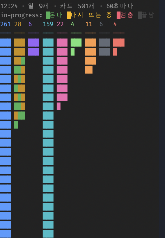
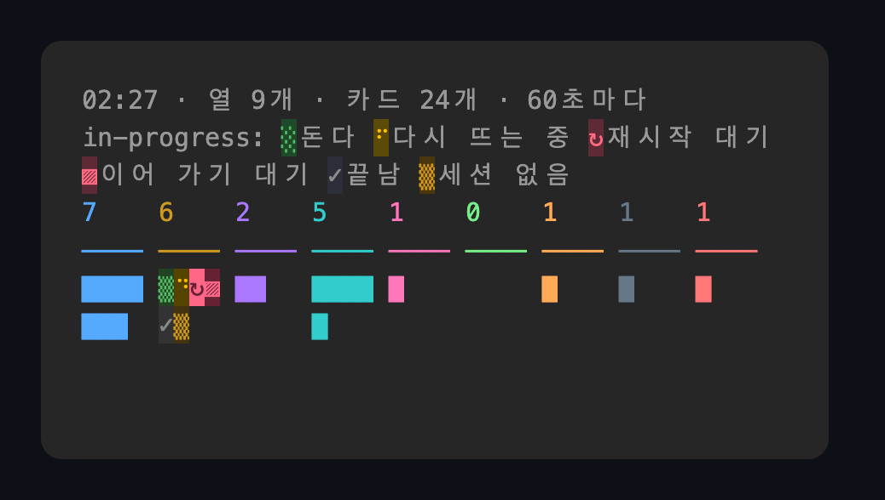

# uhd-kanban: Claude Code 용 마크다운 칸반 보드

[](plugins/uhd-kanban/LICENSE)
[](plugins/uhd-kanban/.claude-plugin/plugin.json)
[](https://github.com/anthropics/claude-code)
[](https://nodejs.org)

[English](README.md) | 한국어

**uhd-kanban** 은 프로젝트마다 칸반 보드를 `kanban/` 디렉터리의 마크다운 파일로 운영하는 Claude Code 플러그인이다. 메인 세션이 요청을 카드로 나누고, 카드마다 백그라운드 세션(`claude --bg`)을 하나씩 띄워 맡기고, 결과를 검토한다. Claude Code 의 pane 이 열마다 카드 수와 카드 세션이 도는지를 보인다.



*카드 501장인 보드의 보드 모니터 pane. pane 은 카드 수와 세션 상태만 보이고 카드 제목은 보이지 않는다.*

## 목차

- [uhd-kanban 의 기능](#uhd-kanban-의-기능)
- [플러그인 구성](#플러그인-구성)
- [빠른 시작](#빠른-시작)
- [언어](#언어)
- [보드 파일 배치](#보드-파일-배치)
- [카드 세션에 작업 맡기기](#카드-세션에-작업-맡기기)
- [명령](#명령)
- [보드 모니터 pane](#보드-모니터-pane)
- [필요한 것](#필요한-것)
- [자주 묻는 질문](#자주-묻는-질문)
- [출처](#출처)
- [라이선스](#라이선스)

## uhd-kanban 의 기능

| 기능 | 하는 일 |
|---|---|
| 일반 파일 | 카드 하나가 `.md` 파일 하나다. 열은 디렉터리 이름이, 열 안의 순서는 파일 이름 앞의 순서 번호가 갖는다. 그래서 `ls` · `git diff` · 아무 편집기로나 보드를 읽는다. 서버 · 데이터베이스 · 계정이 없다. |
| 위임 | 메인 세션은 코드를 고치지 않는다. 카드마다 `claude --bg` 세션이 따로 돌고 그 세션은 카드 본문만 프롬프트로 받으므로, 메인 세션의 문맥에 구현 과정이 쌓이지 않는다. |
| 편집 확인 | 메인 세션이 Edit · Write · NotebookEdit 로 프로젝트 파일을 고치려 하면 훅이 사용자에게 확인 창을 띄운다. `bypassPermissions` 를 포함한 모든 권한 모드에서 뜬다. |
| 의존성 · 동시 실행 상한 | `depends_on` 에 적은 카드가 끝나기 전에는 카드를 시작하지 않는다. `run.max_parallel`(기본 3)이 동시에 도는 카드 세션 수를 제한한다. |
| 이어 가기 | `uk recover` 가 멈췄거나 데몬이 다시 띄운 카드 세션을 이어 가고 새 session id 를 카드에 적는다. |
| 보드 모니터 | pane 이 카드 하나를 한 칸으로 그리고, in-progress 열의 칸은 세션 상태로 색을 바꾼다. 기본 갱신 주기는 60초다. |

## 플러그인 구성

| 구성 | 경로 | 하는 일 |
|---|---|---|
| 스킬 `uhd-kanban` | [`plugins/uhd-kanban/skills/uhd-kanban/`](plugins/uhd-kanban/skills/uhd-kanban/SKILL.md) | 카드 만들기 · 열 옮기기 · 순서 바꾸기 · 코멘트 · 아카이브. 카드를 `claude --bg` 세션으로 실행하기. 멈춘 세션 이어 가기 |
| 스킬 `delegate` | [`plugins/uhd-kanban/skills/delegate/`](plugins/uhd-kanban/skills/delegate/SKILL.md) | 보드가 있는 프로젝트의 메인 세션이 지킬 규칙. 작업을 카드로 나누고, `uk run` 으로 맡기고, 결과를 검토하고, 카드를 옮긴다 |
| hooks 모듈 | [`plugins/uhd-kanban/hooks/register.tsx`](plugins/uhd-kanban/hooks/register.tsx) | 세션 디렉터리 위에 `.uhd-kanban/config.json` 이 있으면 보드 모니터 pane 을 열고, `/kanban-board` 명령을 등록하고, Edit · Write · NotebookEdit 앞에서 `uk guard` 를 실행한다 |

## 빠른 시작

1. Claude Code 안에서 이 저장소의 마켓플레이스로 플러그인을 설치한다.

   ```
   /plugin marketplace add hwanyong/skill-kanban
   /plugin install uhd-kanban@skill-kanban
   ```

2. 프로젝트 루트에 보드를 만든다. Claude 에게 uhd-kanban 보드를 만들어 달라고 하거나 직접 실행한다.

   ```sh
   node ~/.claude/plugins/cache/skill-kanban/uhd-kanban/<버전>/skills/uhd-kanban/bin/uhd-kanban.mjs init --locale ko
   ```

   `.uhd-kanban/config.json` · `.uhd-kanban/profiles.json` · `kanban/` 이 생긴다. 이미 있으면 바꾸지 않고 종료 코드 1 로 끝난다.

3. 프로젝트 루트에서 `claude` 를 한 번 열어 workspace trust 대화 상자를 수락한다. `claude --bg` 는 상위 디렉터리의 trust 를 물려받지 않으므로, 수락하기 전에는 `uk run` 이 `Workspace not trusted` 로 실패한다.

4. 메인 세션에 작업을 맡긴다. `delegate` 스킬에 따라 메인 세션이 작업을 카드로 나누고 `uk run` 으로 띄운 뒤 카드 id · 결과 · 남은 결정을 보고한다.

내려받은 폴더로 설치하려면 `claude plugin marketplace add <폴더>` 뒤 `claude plugin install uhd-kanban@skill-kanban` 을 실행한다. 이때 Claude Code 는 그 폴더를 직접 읽으므로, 고친 뒤 `/reload-plugins` 로 다시 읽는다.

## 언어

보드마다 언어가 하나이고 `.uhd-kanban/config.json` 의 `locale`(`ko` · `en`)이 정한다. 명령 출력 · 카드 세션에 주는 프롬프트 · 보드 모니터 pane 의 글이 이 언어를 따른다. `uk init --locale ko|en` 이 이 값을 적는다. `--locale` 이 없으면 `init` 은 그때의 `LC_ALL` · `LC_MESSAGES` · `LANG` 으로 정한다(`ko` 로 시작하면 `ko`, 나머지는 `en`). `locale` 이 없는 보드는 실행할 때마다 그 변수를 따른다.

카드 파일에 적는 값은 언어와 무관하다. status · type · 코멘트 kind 는 `progress` · `question` · `result` 같은 영어 id 다. 한국어 보드는 kind 를 `progress(진행)` 처럼 보인다.

0.4.0 까지 만든 보드는 코멘트 kind 를 한국어 낱말로 적었다. `uk check` 가 이것을 알리고 `uk migrate` 가 바꾼다.

```sh
uk migrate --dry-run   # 바꿀 것을 출력한다
uk migrate             # comments.kinds 를 바꾸고 "locale": "ko" 를 넣고, 모든 카드의 코멘트 머리 줄을 바꾼다
```

바뀌는 것은 `### c<n> [<kind>]` 머리 줄과 `config.json` 의 두 줄뿐이다. 다시 실행하면 아무것도 바꾸지 않는다. `uk comment --kind` · `uk inbox --kind` 는 이전 한국어 낱말 14개(`lib/kinds.mjs`)도 받아 id 로 적으므로, migrate 전에 띄운 카드 세션도 그대로 동작한다.

## 보드 파일 배치

| 경로 | 내용 |
|---|---|
| `.uhd-kanban/config.json` | 열 · type 마다 처음 둘 열 · 순서 번호 · 의존성 규칙 · 코멘트 kind · 아카이브 규칙 · `run` 설정 · `monitor` 설정 |
| `.uhd-kanban/profiles.json` | `model:` 태그의 프로필 이름을 `claude --model` 값으로 바꾸는 표 |
| `kanban/<n>-<status>/<순서 번호>-k<id>-<제목>.md` | 열 안의 카드. 예: `kanban/1-to-do/0010-k457-로그인-오류-재현.md` |
| `kanban/archived/<YYYY-MM>/<YYYY-MM-DD>-k<id>-<제목>.md` | 아카이브한 카드. 날짜는 `completed_at` 의 날짜다 |

카드는 YAML frontmatter · 본문 · `## Comments` 절로 이루어진다. `uk run` 은 본문을 카드 세션의 프롬프트로 쓴다.

```markdown
---
id: 457
type: task
title: 로그인 오류 재현
priority: high
tags: [model:deep, effort:high]
depends_on: [455]
created_at: 2026-10-29T08:00:00Z
updated_at: 2026-10-29T09:10:00Z
---

목표 · 고칠 파일이나 범위 · 하지 않을 것 · 끝난 판정.

## Comments

### c1 [assign] from=user to=k457 at=2026-10-29T09:00:00Z

claude --bg 로 시작했다. session=… model=opus(model:deep) effort=high
```

frontmatter · 파일 이름 · 디렉터리는 명령으로만 바꾼다. 명령은 잠금(`.uhd-kanban/lock/` 디렉터리) 안에서 파일 이름과 frontmatter 를 함께 바꾼다. 카드 본문을 직접 고쳤으면 `uk check` 를 실행한다.

### 기본 열

| 디렉터리 | `status` | 둘 수 있는 type | 뜻 |
|---|---|---|---|
| `1-to-do` | `to-do` | task · bug · decision | 아직 시작하지 않은 일 |
| `2-in-progress` | `in-progress` | task · bug · decision | 카드 세션이 진행 중인 일 |
| `3-in-review` | `in-review` | task · bug | 구현을 마치고 검토를 기다리는 일 |
| `4-done` | `done` | task · bug · decision · milestone | 끝난 일 |
| `5-decided` | `decided` | decision | 결정했지만 아직 반영하지 않은 결정 |
| `6-planned` | `planned` | milestone | 계획만 있는 milestone |
| `7-implemented` | `implemented` | decision | 코드에 반영까지 끝난 결정 |
| `8-cancelled` | `cancelled` | task · bug · decision | 하지 않기로 한 일 |
| `9-active` | `active` | milestone | 진행 중인 milestone |

| type | 열의 차례 |
|---|---|
| task · bug | `to-do` → `in-progress` → `in-review` → `done`. 그만두면 `cancelled` |
| decision | `to-do` → `in-progress` → `decided` → `implemented`. 반영할 코드가 없으면 `done`, 정하지 않기로 하면 `cancelled` |
| milestone | `planned` → `active` → `done` |

## 카드 세션에 작업 맡기기

`uk run k457` 이 하는 일은 네 가지다.

1. 카드의 `model:<프로필>` 태그를 `profiles.json` 으로 `--model` 값으로 바꾸고, `effort:<값>` 태그를 `--effort` 로 넘긴다.
2. `uk move` 와 같은 의존성 검사를 거쳐 카드를 `run.status` 열(`in-progress`)로 옮긴다.
3. 프로젝트 루트에서 `claude --bg --dangerously-skip-permissions -n k457 --model … <프롬프트>` 를 실행한다. 프롬프트는 카드 본문 뒤에 `progress` · `question` · `result` 코멘트를 남기는 명령과 결과 뒤에 카드를 옮기는 명령을 붙인 것이다.
4. 카드에 `session` · `session_started_at` 을 적고 `assign` 코멘트를 남긴다.

카드 세션은 확인 창에 답할 사람이 없으므로 권한 확인 없이 돈다. 카드 세션은 모두 같은 작업 트리에서 돌기 때문에, 같은 파일 · 같은 생성물 · 같은 장치를 다루는 카드는 `depends_on` 으로 차례를 정한다.

| 태그 | `--model` |
|---|---|
| `model:top` | `fable` |
| `model:deep-1m` | `opus[1m]` |
| `model:deep` | `opus` |
| `model:standard` | `sonnet` |
| `model:fast` | `haiku` |
| `model:user` | 없음. 사람이 하는 카드이고 `uk run` 이 띄우지 않는다 |

카드 세션은 코멘트로 보고한다. `uk comment` 는 코멘트를 덧붙이고 받는 세션 앞으로 보낼 `SendMessage` 줄을 출력하고, `uk inbox` 는 그 세션 앞으로 온 코멘트 중 답하지 않은 것을 출력한다.

## 명령

스킬 문서에서 `uk` 는 `node <스킬 폴더>/bin/uhd-kanban.mjs` 를 줄여 적은 것이다. 대개 사용자가 직접 입력하지 않고 Claude 가 스킬에 따라 실행한다. 카드는 `k457` 또는 `457` 로 가리킨다.

| 명령 | 하는 일 |
|---|---|
| `uk init` | `.uhd-kanban/` 과 `kanban/` 을 만든다. `--locale ko\|en` 이 보드의 언어를 정한다 |
| `uk check` | 설정과 모든 카드를 검증한다. 파일은 바꾸지 않는다 |
| `uk new` | 카드를 만든다 |
| `uk move` | 의존성을 검사하고 카드를 다른 열로 옮긴다 |
| `uk order` | 같은 열 안에서 카드의 자리를 바꾼다 |
| `uk renumber` | 한 열의 순서 번호를 다시 매긴다 |
| `uk set` | 제목 · 우선순위 · 태그 · `depends_on` · `collection` 을 바꾼다 |
| `uk archive` | 끝난 뒤 `archive.after_days`(기본 7)일이 지난 카드를 `kanban/archived/` 로 옮긴다 |
| `uk comment` | 코멘트를 덧붙이고 `SendMessage` 줄을 출력한다 |
| `uk inbox` | 한 세션 앞으로 온 코멘트 중 답하지 않은 것을 출력한다 |
| `uk run` | 카드를 `claude --bg` 세션으로 띄운다 |
| `uk recover` | 멈춘 카드 세션을 `claude --bg --resume` 으로 이어 간다 |
| `uk guard` | 그 세션이 그 파일을 고쳐도 되는지 판정한다(훅이 쓴다) |
| `uk board` | 열마다 카드 수와 세션 상태를 출력한다(pane 이 쓴다) |
| `uk migrate` | 0.4.0 까지 만든 보드의 kind 를 영어 id 로 바꾸고 `locale` 을 넣는다 |
| `uk locale` | 지금 디렉터리에서 쓸 언어를 출력한다(pane 이 쓴다) |

종료 코드는 `0` 성공 · `1` 규칙 위반이나 실행 실패(내용은 stderr) · `2` 사용법 오류 · `3` 부른 디렉터리 위에 보드가 없음이다. 전체 옵션은 [`SKILL.md`](plugins/uhd-kanban/skills/uhd-kanban/SKILL.md#명령) 에 있다.

아래 데모 보드에서 `uk board` 를 실행한 출력:

```
1-to-do 7개
2-in-progress 3개 (세션: live 2 · none 1)
3-in-review 2개
4-done 8개
5-decided 1개
6-planned 0개
7-implemented 1개
8-cancelled 1개
9-active 1개
```

## 보드 모니터 pane



*가상의 카드 24장과 실행 중인 카드 세션 두 개가 있는 데모 보드.*

pane 은 세션 디렉터리 위에 `.uhd-kanban/config.json` 이 있으면 열린다. 맨 위 줄의 수는 `config.json` 의 `columns` 차례대로 열마다 카드 수이고, 막대는 카드 하나를 한 칸으로 아래로 자란다. 닫힌 pane 은 `/kanban-board` 로 다시 연다.

| in-progress 열의 칸 색 | 세션 상태 |
|---|---|
| 초록 | 돈다 |
| 노랑 | 다시 뜨는 중 |
| 빨강 | 멈춤(`uk recover` 로 이어 간다) |
| 회색 | 끝남 |
| 열의 색 | 카드에 세션이 없다 |

갱신 주기는 `config.json` 의 `monitor.interval_seconds` 다(10 이상의 정수, 기본 60).

카드 한 장이 막대에서 차지하는 칸은 `config.json` 의 `monitor.cell` 이 정한다. 막대 폭은 어느 방식이든 가장 큰 카드 수의 자릿수보다 좁아지지 않는다.

| `monitor.cell` | 카드 한 장 | 막대 폭 | 카드가 적은 보드 | 카드가 수백 장인 보드 |
|---|---|---|---|---|
| `char`(기본값, 키가 없을 때도 이 값) | 문자 하나 | 가장 긴 막대가 pane 높이에 들어가는 가장 좁은 폭. pane 폭을 열 수로 나눈 폭을 넘지 않는다 | 막대가 1칸 | 한 행에 카드 여러 장, 한 장이 문자 하나 |
| `row` | 막대의 한 행 | pane 폭을 열 수로 나눈 폭 | 카드 한 장이 막대 폭을 채운다 | 한 행에 카드 한 장이라 긴 막대는 스크롤이 늘어난다 |
| `fit` | `막대 폭 ÷ 한 행의 카드 수` 문자 | pane 폭을 열 수로 나눈 폭 | `row` 와 같다 | 한 행의 카드 수는 가장 긴 막대가 pane 높이에 들어가는 수이고, 칸 폭은 막대 폭을 그 수로 나눈 몫이다 |

pane 높이에 들어가지 않는 막대는 어느 방식이든 스크롤한다.

## 필요한 것

- Claude Code 2.1.312 이상(hooks 모듈 API 를 이 판에서 확인했다)
- `PATH` 에 있는 Node.js 21 이상(`Object.groupBy`)
- macOS 에서 개발했다. 다른 플랫폼에서는 확인하지 않았다.

## 자주 묻는 질문

### uhd-kanban 은 무엇인가?

칸반 보드를 프로젝트 안의 마크다운 파일로 저장하고, Claude Code 메인 세션이 카드마다 백그라운드 세션을 하나씩 띄워 맡기게 하는 Claude Code 플러그인이다. 스킬 두 개(`uhd-kanban` · `delegate`)와 보드 모니터 pane 을 그리는 hooks 모듈이 들어 있다.

### 서버 · 데이터베이스 · 계정이 필요한가?

필요하지 않다. 보드는 `kanban/` 디렉터리와 `.uhd-kanban/` 설정이고, 명령은 그 파일을 읽고 쓰는 Node.js 스크립트다.

### 호스팅 이슈 트래커와 무엇이 다른가?

보드가 저장소 안에 있으므로 카드가 코드와 함께 버전 관리되고, Claude 세션이 파일 명령으로 카드를 읽고 쓴다. 호스팅 트래커는 카드를 저장소 밖에 두고 API 와 계정이 있어야 한다.

### 카드 세션은 동시에 몇 개까지 도는가?

기본 3개다. `.uhd-kanban/config.json` 의 `run.max_parallel` 에 다른 양의 정수를 적거나, 제한을 없애려면 `-1` 을 적는다. 상한에 차면 `uk run` 이 카드를 띄우지 않고 종료 코드 1 로 끝난다.

### 카드를 직접 고쳐도 되는가?

카드 본문(`## Comments` 앞)은 직접 고치고 `uk check` 를 실행한다. frontmatter · 파일 이름 · 열은 `uk new` · `uk set` · `uk move` · `uk order` 로 바꾸고, 코멘트는 `uk comment` 로 남긴다.

### 카드 세션이 멈추면 어떻게 되는가?

`uk board` 와 pane 이 멈춤으로 표시한다. `uk recover` 가 `claude --bg --resume` 으로 이어 가고, 새 session id 를 카드에 적고, `assign` 코멘트를 남긴다. 검토에서 돌아온 카드는 `uk recover --force k<id>` 로 이어 간다.

### git worktree 에서도 쓸 수 있는가?

쓸 수 있다. git worktree 안에서 명령을 부르면 주 worktree 의 보드를 쓰므로 카드 id 와 순서 번호가 한 벌로 유지된다.

### 직접 하라고 하면 메인 세션이 파일을 고칠 수 있는가?

고칠 수 있다. 편집 확인 훅은 거절하지 않고 확인 창을 띄운다. 그 요청에서 확인 창을 허용하면 된다.

## 출처

[mattjoyce/kanban-skill](https://github.com/mattjoyce/kanban-skill)(커밋 b86a6ec, Apache-2.0)을 참고해 Node.js ESM 으로 새로 작성했다.

## 라이선스

[MIT](plugins/uhd-kanban/LICENSE)
