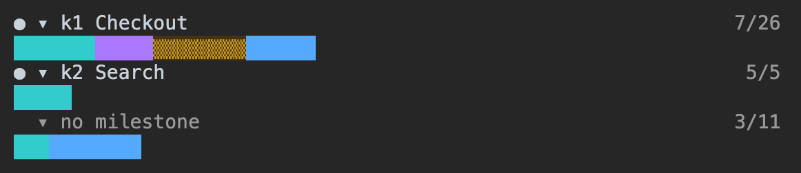

# uhd-kanban: a Markdown Kanban board for Claude Code

[](plugins/uhd-kanban/LICENSE)
[](plugins/uhd-kanban/.claude-plugin/plugin.json)
[](https://github.com/anthropics/claude-code)
[](https://nodejs.org)

English | [한국어](README.ko.md)

**uhd-kanban** is a Claude Code plugin that keeps a per-project Kanban board as plain Markdown files in `kanban/`. The main Claude Code session splits a request into cards, starts one background session (`claude --bg`) per card, and reviews each result. A side pane in Claude Code shows the cards of each milestone by column and whether each card session is running.

Nothing is installed besides the plugin: no Docker, no server, no database, no npm packages. The board is Markdown and JSON files in a fixed format that `uk check` verifies, and the commands use only Node.js built-in modules.


*A sample board with fictional cards. The pane was captured from a Claude Code session with test `board` output, so no card sessions ran. The capture copy was changed to reread the board every second. The line under the pane names the step and is not part of the pane. The pane shows milestone titles, counts and session states; work card titles are not displayed.*

> [!NOTE]
> Command output, card session prompts and pane labels are available in English and Korean (see [Language](#language)). The skill documents (`SKILL.md`) are written in Korean and include English trigger phrases.

## Contents

- [Why uhd-kanban](#why-uhd-kanban)
- [What is in the plugin](#what-is-in-the-plugin)
- [Quick start](#quick-start)
- [Language](#language)
- [How the board is stored](#how-the-board-is-stored)
- [Delegating work to card sessions](#delegating-work-to-card-sessions)
- [Commands](#commands)
- [Board monitor pane](#board-monitor-pane)
- [Requirements](#requirements)
- [Usage notes](#usage-notes)
- [FAQ](#faq)
- [Credits](#credits)
- [License](#license)

## Why uhd-kanban

| Feature | What it does |
|---|---|
| Plain files | One card is one `.md` file. The column is the directory name and the order is the number prefix of the file name, so `ls`, `git diff` and any editor show the board. No Docker, no server, no database, no account, no npm packages: the commands import only Node.js built-in modules (`node:fs`, `node:child_process` and others). |
| Delegation | The main session does not write code. Each card runs in its own `claude --bg` session that receives only the card body as its prompt, so the main session's context does not fill with implementation details. |
| Edit guard | A hook asks the user before the main session edits a project file with Edit, Write or NotebookEdit. The question appears in every permission mode, including `bypassPermissions`. |
| Dependencies and a parallel limit | `depends_on` keeps a card from starting before the cards it waits for are finished. `run.max_parallel` (default 3) caps the number of card sessions that run at once. |
| Recovery | `uk recover` resumes card sessions that stopped or were respawned by the daemon, and records the new session id on the card. |
| Board monitor | A pane draws one row per milestone with one cell per member card, animates the in-progress cells by session state, and plays a rearrangement when cards are created, deleted or moved. Rows collapse by click or keyboard. It rereads the board every 60 seconds by default. |

## What is in the plugin

| Component | Path | Purpose |
|---|---|---|
| Skill `uhd-kanban` | [`plugins/uhd-kanban/skills/uhd-kanban/`](plugins/uhd-kanban/skills/uhd-kanban/SKILL.md) | Create, move, reorder, comment on and archive cards. Run a card as a `claude --bg` session. Resume stopped sessions. |
| Skill `delegate` | [`plugins/uhd-kanban/skills/delegate/`](plugins/uhd-kanban/skills/delegate/SKILL.md) | Rules for the main session of a project with a board: split work into cards, run them with `uk run`, review results, move cards. |
| Hooks module | [`plugins/uhd-kanban/hooks/register.tsx`](plugins/uhd-kanban/hooks/register.tsx) | Opens the board monitor pane when `.uhd-kanban/config.json` exists above the session directory, registers the `/kanban-board` command, and runs `uk guard` before Edit, Write and NotebookEdit. |

## Quick start

1. Install the plugin from this repository's marketplace inside Claude Code:

   ```
   /plugin marketplace add hwanyong/skill-kanban
   /plugin install uhd-kanban@skill-kanban
   ```

2. Create a board in the project root. Ask Claude to initialize a uhd-kanban board, or run the command yourself:

   ```sh
   node ~/.claude/plugins/cache/skill-kanban/uhd-kanban/<version>/skills/uhd-kanban/bin/uhd-kanban.mjs init --locale en
   ```

   This creates `.uhd-kanban/config.json`, `.uhd-kanban/profiles.json` and `kanban/`. If they already exist, nothing is changed and the command exits with code 1.

3. Open `claude` once in the project root and accept the workspace trust dialog. `claude --bg` does not inherit trust from parent directories, so `uk run` fails with `Workspace not trusted` until you do.

4. Give the main session a task. With the `delegate` skill, it splits the task into cards, starts them with `uk run`, and reports card ids, results and open decisions back to you.

To install from a local clone instead, run `claude plugin marketplace add <folder>` and then `claude plugin install uhd-kanban@skill-kanban`. Claude Code then reads that folder directly; run `/reload-plugins` after editing it.

## Language

Each board has one language, set by `locale` in `.uhd-kanban/config.json` (`en` or `ko`). It selects the language of command output, of the prompts given to card sessions, and of the board monitor pane. `uk init --locale en|ko` writes it; without `--locale`, `init` takes it from `LC_ALL`, `LC_MESSAGES` or `LANG` at that moment (a value starting with `ko` gives `ko`, anything else `en`). A board without `locale` follows those variables on every run.

Values written into card files do not depend on the language. Statuses, types and comment kinds are English ids such as `progress`, `question` and `result`. A Korean board shows a kind as `progress(진행)`.

Boards created with 0.4.0 or earlier recorded comment kinds as Korean words. `uk check` reports this, and `uk migrate` converts them:

```sh
uk migrate --dry-run   # prints what would change
uk migrate             # rewrites comments.kinds, adds "locale": "ko", and rewrites comment header lines in every card
```

Only the `### c<n> [<kind>]` header lines and two lines of `config.json` change. Running it again changes nothing. `uk comment --kind` and `uk inbox --kind` still accept the 14 old Korean words (`lib/kinds.mjs`) and record the id, so card sessions started before the migration keep working.

## How the board is stored

![Diagram of how uhd-kanban stores a board, drawn from the files of a demo board with 24 cards. Left: the file tree of sample-app. .uhd-kanban/config.json holds the locale, 9 columns and the run, archive and monitor settings; .uhd-kanban/profiles.json maps model: tags to claude --model values. The column directories under kanban/ are 1-to-do (7 cards), 2-in-progress (3), 3-in-review (2), 4-done (8), 5-decided (1), 7-implemented (1), 8-cancelled (1) and 9-active (1). 6-planned/ is absent, because a column directory exists only while it holds cards. Top right: the path kanban/2-in-progress/0030-k2-Add-login-form-validation.md split into the column directory 2-in-progress (status in-progress), the order in the column 0030, the card id k2 and the title Add-login-form-validation. Bottom right: the 29 lines of that file. Lines 1 to 13 are YAML frontmatter (id, type, title, priority, tags, depends_on, collection, created_at, updated_at, session, session_started_at); only uk commands change it, together with the file name and directory, while holding the .uhd-kanban/lock/ directory. collection holds the ids of the milestones the card belongs to. Line 15 is the body, which uk run puts in the prompt of the card session. Lines 17 to 29 are ## Comments with three blocks: c1 [assign] is the record from uk run, c2 [question] is the question of the card session and c3 [answer] is the answer of the user.](docs/images/board-storage.en.png)

*Generated from the files of a demo board made with `uk` commands. The tree and the file content are the files on disk; lines longer than the view end in …. No card session was started: `uk run` ran against a `claude` stub (a script that replaces the real program and returns fixed values) that only writes a session list to a file, and c2 and c3 were written with `uk comment`.*

| Path | Content |
|---|---|
| `.uhd-kanban/config.json` | Columns, the initial column per card type, order numbering, dependency rules, comment kinds, archive rules, `run` settings and `monitor` settings |
| `.uhd-kanban/profiles.json` | Maps `model:` tag profiles to `claude --model` values |
| `kanban/<n>-<status>/<order>-k<id>-<title>.md` | A card in a column, for example `kanban/1-to-do/0010-k457-fix-login-error.md` |
| `kanban/archived/<YYYY-MM>/<YYYY-MM-DD>-k<id>-<title>.md` | An archived card. The date is the date of `completed_at`. |

A card is YAML frontmatter, a body, and a `## Comments` section. `uk run` uses the body as the prompt of the card session. `collection` lists the ids of the milestones the card belongs to and decides its rows in the [board monitor pane](#board-monitor-pane).

```markdown
---
id: 457
type: task
title: Fix login error
priority: high
tags: [model:deep, effort:high]
depends_on: [455]
collection: [450]
created_at: 2026-10-29T08:00:00Z
updated_at: 2026-10-29T09:10:00Z
---

Goal, files to change, what not to do, and how to verify the result.

## Comments

### c1 [assign] from=user to=k457 at=2026-10-29T09:00:00Z

Started with claude --bg. session=… model=opus(model:deep) effort=high
```

Frontmatter, file names and directories are changed only through commands. The commands take a lock (the `.uhd-kanban/lock/` directory) and update the file name and the frontmatter together. After editing a card body by hand, run `uk check`.

### What `uk check` verifies

The format is fixed, so `uk check` alone verifies every card file. Commands that change the board run the same check first and change nothing while a rule is broken.

| Target | Rule |
|---|---|
| File name | `<order>-k<id>-<title>.md`. The order number has `order.width` digits (default 4) and appears once per column |
| File name and frontmatter | `id` equals the `k<id>` of the file name, and the title part equals `title` |
| Directory | Every directory and file under `kanban/` is a column in `columns` of `config.json` or `archive.dir` (default `archived/`) |
| Column and `type` | The card `type` is in `types` of its column |
| Card id | One card id appears in one place on the board |
| Frontmatter values | `title` has no control characters, `priority` is a known value, `tags` is a list of strings, `depends_on` and `collection` are lists of card ids |
| Comments | Each `### c<n> [kind]` kind is in `comments.kinds` of `config.json` |

### Default columns

| Directory | `status` | Card types it accepts | Meaning |
|---|---|---|---|
| `1-to-do` | `to-do` | task, bug, decision | Not started |
| `2-in-progress` | `in-progress` | task, bug, decision | A card session is working on it |
| `3-in-review` | `in-review` | task, bug | Implemented, waiting for review |
| `4-done` | `done` | task, bug, decision, milestone | Finished |
| `5-decided` | `decided` | decision | Decided, not yet applied |
| `6-planned` | `planned` | milestone | Planned milestone |
| `7-implemented` | `implemented` | decision | Decision applied to the code |
| `8-cancelled` | `cancelled` | task, bug, decision | Will not be done |
| `9-active` | `active` | milestone | Milestone in progress |

| Card type | Column order |
|---|---|
| task, bug | `to-do` → `in-progress` → `in-review` → `done`, or `cancelled` |
| decision | `to-do` → `in-progress` → `decided` → `implemented`, or `done` when no code change is needed, or `cancelled` |
| milestone | `planned` → `active` → `done` |

## Delegating work to card sessions

`uk run k457` does four things:

1. Converts the card's `model:<profile>` tag to `--model` through `profiles.json`, and passes an `effort:<value>` tag as `--effort`.
2. Moves the card to the `run.status` column (`in-progress`) after the same dependency check as `uk move`.
3. Runs `claude --bg --dangerously-skip-permissions -n k457 --model … <prompt>` in the project root. The prompt is the card body plus instructions for leaving `progress`, `question` and `result` comments and for moving the card after the result.
4. Writes `session` and `session_started_at` to the card and adds an `assign` comment.

Card sessions run without permission prompts because nobody is present to answer them. They all share the project's working tree, so cards that change the same files, generated files or devices must be ordered with `depends_on`.

| Tag | `--model` |
|---|---|
| `model:top` | `fable` |
| `model:deep-1m` | `opus[1m]` |
| `model:deep` | `opus` |
| `model:standard` | `sonnet` |
| `model:fast` | `haiku` |
| `model:user` | none. The card is for a person and `uk run` does not start it. |

Card sessions report back through comments. `uk comment` appends a comment and prints a `SendMessage` line for the recipient session, and `uk inbox` lists comments addressed to a session that have not been answered.

## Commands

In the skill documents, `uk` stands for `node <skill folder>/bin/uhd-kanban.mjs`. You usually do not type these commands; Claude runs them through the skills. Cards are referred to as `k457` or `457`.

| Command | What it does |
|---|---|
| `uk init` | Creates `.uhd-kanban/` and `kanban/`. `--locale en\|ko` sets the board language |
| `uk check` | Validates the configuration and every card without changing files |
| `uk new` | Creates a card |
| `uk move` | Moves a card to another column, with dependency checks |
| `uk order` | Changes a card's position within its column |
| `uk renumber` | Renumbers the order prefixes of one column |
| `uk set` | Changes title, priority, tags, `depends_on` or `collection` |
| `uk archive` | Moves finished cards older than `archive.after_days` (default 7) to `kanban/archived/` |
| `uk comment` | Appends a comment and prints the `SendMessage` line |
| `uk inbox` | Lists unanswered comments addressed to a session |
| `uk run` | Starts a card as a `claude --bg` session |
| `uk recover` | Resumes stopped card sessions with `claude --bg --resume` |
| `uk guard` | Decides whether a session may edit a file (used by the hook) |
| `uk board` | Prints card counts per column, session states, and finished / total per milestone (used by the pane) |
| `uk migrate` | Converts a board made with 0.4.0 or earlier to English kind ids and adds `locale` |
| `uk locale` | Prints the language used in the current directory (used by the pane) |

Exit codes: `0` success, `1` rule violation or failure (details on stderr), `2` usage error, `3` no board above the current directory. Full options are in [`SKILL.md`](plugins/uhd-kanban/skills/uhd-kanban/SKILL.md#명령).

Example output of `uk board` for the demo board in [How the board is stored](#how-the-board-is-stored) (`locale` `en`):

```
1-to-do 7
2-in-progress 3 (sessions: none 2 · resume 1)
3-in-review 2
4-done 8
5-decided 1
7-implemented 1
8-cancelled 1
k1 v1.0 release (active) 7/17
no milestone 4/6
```

The counts cover work cards only. `6-planned` and `9-active` take only milestones, so they are not listed. No session was really started for k2 on this board, so its state is `resume`.

## Board monitor pane

![The board monitor pane for a demo board with 24 work cards and 2 milestones. Below the header line and the legend are 3 rows, each with the collapse symbol ▾. Row k1 has a yellow braille head symbol and reads 2/9 finished of total, and its bar holds from the left 2 done cells, 1 in-review cell, 3 in-progress cells (green shaded block, yellow braille, gray check mark) and 3 to-do cells. Row k2 has a hollow circle, a dim title, reads 0/3 and holds 3 to-do cells. The no milestone row has a red arrow, reads 4/12, and holds 4 done cells, 1 in-review cell, 2 in-progress cells (red arrow, red hatch) and 5 to-do cells.](docs/images/board-monitor-demo.en.png)

*Captured from a test `board` output with 24 fictional work cards. It was made to show several session states and is a different board from the demo board in [How the board is stored](#how-the-board-is-stored).*

The pane opens when `.uhd-kanban/config.json` exists above the session directory. Reopen a closed pane with `/kanban-board`. The top line holds the time, the number of work cards, the number of unfinished milestones and the refresh interval, followed by a legend of column colors and session states. Below it each unfinished milestone has one row (a swimlane: a horizontal row grouped by membership), and cards with an empty `collection` are in the last `no milestone` row. Rows are ordered `active` milestones, `planned` milestones, then `no milestone`.

| Part of a row | What it shows |
|---|---|
| Head symbol | `●` for `active`, `○` for `planned`. When a member card has the session state `restart`, `pending`, `live` or `resume`, the symbol becomes the character of the first one in that order |
| Collapse symbol | `▾` for a row with its bar expanded, `▸` for a collapsed row |
| Title | `k<id>` and the milestone title, dimmed for `planned`. Work card titles are not displayed |
| Number on the right | Finished member cards / all member cards, counting archived cards. Finished means in a column of `dependencies.resolved` or `dependencies.abandoned` |
| Bar | One cell per member work card, wrapping at the pane width. The cell color is the card's column, ordered from the left: finished columns (`done`, `decided`, `implemented`, `cancelled`), `in-review`, `in-progress`, `to-do` |

- A card's milestones are its `collection`. A card in several milestones has a cell in each row.
- A milestone moved to `done` has no row. Its member cards appear in no row and still count in the per-column numbers of the legend.
- Click `▾ k<id>` on a head line to collapse the bar of that row, and click it again to expand it. With the keyboard, move the focus to the pane with `ctrl+x tab`, select with `Tab` and press `Enter`. A collapsed row keeps its head symbol animation and the number on the right. The list of collapsed rows is stored per session directory and survives a session restart.
- When a work card moves to the `run.status` column, `uk move`, `uk run` and `uk recover` also move its `planned` milestones to `active`. Other mismatches (`planned` with an `in-progress` member, `active` with every member finished) are reported by `uk check` on stderr and nothing is moved.

| in-progress cell | Legend | Session state | Redraw interval |
|---|---|---|---|
| Green `░▒▓█▓▒`, offset one character per card | `live` | `live`: running | 250 ms |
| Yellow `⠋⠙⠸⠴⠦⠇` | `pending` | `pending`: the daemon is restarting the session | 250 ms |
| Red `↻`, foreground and background swap every frame | `restart` | `restart`: the restarted session is idle and the user had the last turn. `uk recover` stops it, then resumes it | 250 ms |
| Red `▨` | `resume` | `resume`: the session stopped. `uk recover` resumes it | - |
| Gray `✓` | `done` | `done`: finished | - |
| Column color `▒` | `none` | `none`: the card has no session | - |

The refresh interval is `monitor.interval_seconds` in `config.json` (an integer of at least 10, default 60). Version 0.8.0 removed the `monitor.cell` key. If an existing `config.json` still has it, it is ignored without an error.

Rows that do not fit in the pane height scroll. `uk board` opens every card file including the archive to read membership. On a board with 1,277 card files `uk board --json` took 1.24–1.48 s per run over 5 runs (repository on an SMB share).

![The uhd-kanban board monitor pane in Claude Code. The header reads 559 cards, 10 milestones, every 60s, followed by the legend. The rows read, in order, 493/646, 222/233, 9/10, 12/13, 2/3, 118/152, 0/2, 126/184, 0/2 and 3/41 finished of total, and there is no `no milestone` row. The first bar has 6 lines. In the middle of that bar are in-progress cells (1 gray check mark, 5 no-session shades, 4 green shaded blocks), and the head symbol of that row is a green shade character. The sixth bar has 1 no-session shade.](docs/images/board-monitor-559-cards.en.png)

*Captured from the `uk board --json` output of a real project board (559 work cards; the member counts include archived cards). The milestone titles were replaced with fictional ones.*

### Rearrangement


*In row k1: one card deleted, one created and one moved from in-progress to in-review, captured from a pane every 50 ms.*

When a read of `uk board --json` finds that cards were created, deleted or moved, or that a milestone changed column, the pane plays one rearrangement before it shows the new board. Frames are 100 ms apart and a rearrangement takes at most 23 frames (2.3 seconds).

| Step | Frames | What is drawn |
|---|---|---|
| Fade out | 0 or 8 | The cell of a deleted card changes through `▓▒░⠿⠶⠒⠂` while its color moves toward gray, then becomes blank |
| Shift | 0–8 | Remaining cards move to their new places. Cards moving forward go front first and cards moving back go back first, so cells never overlap and the blank only passes between the old and new places. With more than 8 cards to move, several move in one frame |
| Fade in | 0 or 7 | The new card goes through the same characters in reverse |

- The numbers in a head line change to the new values when the rearrangement starts.
- A moved card is a deletion in the old row and a creation in the new one. A card that only changes its place in a row is played the same way, and only the largest set of cards that keep their relative order shifts.
- When a milestone changes column, its head line is inverted for 8 frames. A row missing from the new board stays in its old place and is removed after its cells fade out.
- A card whose session state alone changed is redrawn with no rearrangement.
- The first read after the session starts plays nothing. A change is seen at the next read, so it can be up to `monitor.interval_seconds` late.
- A change that arrives during a rearrangement starts a new one from the final state of the one that was playing.

### Animation examples

Each image is an APNG (animated PNG, a PNG file with several frames that browsers play) of the rows on a fictional board with the columns `to-do`, `in-progress`, `in-review` and `done`. Frames were captured every 50 ms from the pane of a Claude Code session in a tmux window, with a test copy changed to reread the board every second. The session state examples repeat one cycle. The others show the first frame for 1 second and the last frame for 1.5 seconds. Apart from `animation-start`, the rearrangement examples have no sessions on the `in-progress` cards, so only the rearrangement changes.

#### `live`

8 `in-progress` cards. One cycle is 6 frames of 250 ms.


#### `pending`

8 `in-progress` cards. One cycle is 6 frames of 250 ms.


#### `restart`

8 `in-progress` cards. One cycle is 2 frames of 250 ms.


#### All 6 session states

12 `in-progress` cards, 2 per state. `live`, `pending` and `restart` change; `resume`, `done` and `none` stay. The head symbol is `restart`.


#### Delete

The 6th `to-do` card of k1 was deleted. The total goes from 34 to 33.


#### Create

A card was created at the 6th `to-do` place of k1. The total goes from 34 to 35.


#### Move between columns in a row

The 4th `to-do` card of k1 moved to the 2nd place of `in-progress`. The total does not change.


#### Move between rows

The 4th `to-do` card of k1 moved to the 2nd `to-do` place of k2, which is what changing a card's `collection` does.


#### Reorder in a column

The last `to-do` card of k1 moved to the first place.


#### Delete in a long bar

The 3rd of 200 `to-do` cards of k1 was deleted. 197 cards move in 8 frames, so several move in one frame.


#### Milestone starts

The first card of k2 moved to `in-progress`, and `uk move` moved k2 to `active` with it. The card has a `live` session.


#### Milestone finishes

The 5 member cards of k2 finished and k2 moved to `done`. Row k2 is removed and the `no milestone` row stays at 3/11.



#### Collapsing a row

Row k1 was collapsed by clicking `▾ k1` and expanded about 2 seconds later by clicking `▸ k1`. The head numbers stay as they are.


### When the pane animates

`Raster` is the Claude Code element that draws a grid of cells and redraws it without running the render hook (`$.ui.blit`). It exists only on the terminal surface. In each row the head symbol and the bar are separate `Raster` elements, and a frame redraws only the ones that changed. A collapsed row has only the `Raster` of the head symbol.

| Situation | Element drawn | Timer |
|---|---|---|
| Terminal, pane of at most 512 columns and bars of at most 256 rows | `Raster` | 100 ms during a rearrangement, 250 ms while a `live`, `pending` or `restart` card exists, otherwise none |
| Terminal, pane over 512 columns or a bar over 256 rows | `Text`, fixed at the first frame | None |
| Desktop, VS Code and mobile surfaces | `Text`, fixed at the first frame | None |
| The pane is behind another tab | Not redrawn | Checks every second whether it is shown again |
| The pane is closed | - | None |

The desktop, VS Code and mobile rows were not checked in those apps. Colors are fixed RGB values, so the dark cell backgrounds stay the same on a light theme.

Measured on a Mac Studio (`Mac17,14`) with Claude Code 2.1.312 in a 200×50 tmux window, using the `uk board --json` output of a board with 557 work cards and 9 rows. CPU is the increase in `ps -o cputime=` divided by the measured time, and output is the byte count received by `tmux pipe-pane`. The CPU of the terminal app itself is not included.

| State | Measured for | `claude` process CPU | Output to the terminal |
|---|---|---|---|
| Timer off | 30 s | 0.50% | 10 B/s |
| 250 ms interval (3 `live` cards) | 30 s, twice | 2.10%, 2.20% | 852 B/s, 854 B/s |
| Rearrangements with no pause: test `board` output changed the card order every second, with the interval set to 1 second (the `config.json` minimum is 10) | 30 s | 5.50% | 1672 B/s |

In a 15-minute run of two sessions side by side, the session repainting every 250 ms used 2.05% CPU and its RSS (resident memory) went from 438 MB to 486 MB. The session with the timer off used 0.43% CPU and its RSS went from 426 MB to 449 MB. Runs longer than 15 minutes were not measured.

## Requirements

- Claude Code 2.1.312 or later (the hooks module API was checked against this version)
- Node.js 21 or later on `PATH` (`Object.groupBy`)
- Nothing else to install: no Docker, no database, no npm packages. `git` is used only when the project is a git repository (cards tracked by git move with `git mv`).
- Developed on macOS. Other platforms have not been verified.

## Usage notes

- **A control character in a card title stops board edits.** While the `title` of any card contains a control character, `uk check` reports a violation and commands that change the board refuse to run. This includes `uk set --title`, so edit `title` in that card's frontmatter directly and run `uk check` again. The title part of the file name must still match `title`.
- **The rendered pane has not been tested with such a title.** `uk board --json` removes control characters from milestone titles, and the pane draws that value. The JSON output was verified. The pane on screen was not.
- **Uncaught exceptions are not filtered.** Control characters are removed from what commands write to stdout and stderr. When a command ends with an uncaught exception, Node.js prints the error to stderr without going through that filter, so control characters in the error message are output as they are.

## FAQ

### What is uhd-kanban?

A Claude Code plugin that stores a Kanban board as Markdown files inside the project and lets the main Claude Code session hand each card to its own background session. It contains two skills (`uhd-kanban` and `delegate`) and a hooks module that draws the board monitor pane.

### Does it need Docker, a server, a database or an account?

No. The board is the `kanban/` directory and `.uhd-kanban/` configuration. Commands are a Node.js script that reads and writes these files and imports only Node.js built-in modules, so there is no `npm install` and no container.

### How is it different from a hosted issue tracker?

The board is part of the repository, so cards are versioned with the code and Claude sessions read and write them with file commands. A hosted tracker keeps cards outside the repository and needs an API and an account.

### How many card sessions can run at the same time?

Three by default. Set `run.max_parallel` in `.uhd-kanban/config.json` to another positive integer, or to `-1` for no limit. `uk run` refuses to start a card when the limit is reached and exits with code 1.

### Can I edit cards by hand?

You can edit the card body (the part before `## Comments`) and then run `uk check`. Change frontmatter, file names and columns with `uk new`, `uk set`, `uk move` and `uk order`, and add comments with `uk comment`.

### What happens when a card session stops?

`uk board` and the pane show it as stopped. `uk recover` resumes it with `claude --bg --resume`, writes the new session id to the card, and adds an `assign` comment. A card that came back from review is resumed with `uk recover --force k<id>`.

### Why does a card not move to `done` when its session ends?

`done` in the pane legend is a session state, and the `done` column is where a card sits. The tool does not move a card because its session ended. A card session moves the card to its `run.finish` column before it ends (by default `in-review` for task and bug, `decided` for decision). If it ended without moving the card, the main session reads the result comment and decides. If work remains, resume it with `uk recover --force k<id>`. If the work has to wait for another card, add that card with `uk set --add-depends` and move the card back to `to-do`.

### Does it work with git worktrees?

Yes. When a command runs inside a git worktree, it uses the board of the main worktree, so card ids and order numbers stay in one place.

### Can the main session still edit files when I ask it to?

Yes. The edit guard asks instead of refusing. Approve the confirmation prompt for that request.

## Credits

Written from scratch in Node.js ESM with reference to [mattjoyce/kanban-skill](https://github.com/mattjoyce/kanban-skill) (commit b86a6ec, Apache-2.0).

## License

[MIT](plugins/uhd-kanban/LICENSE)
