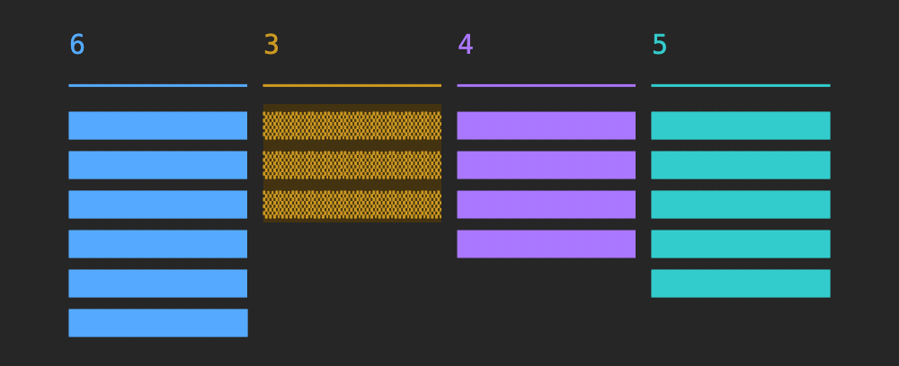
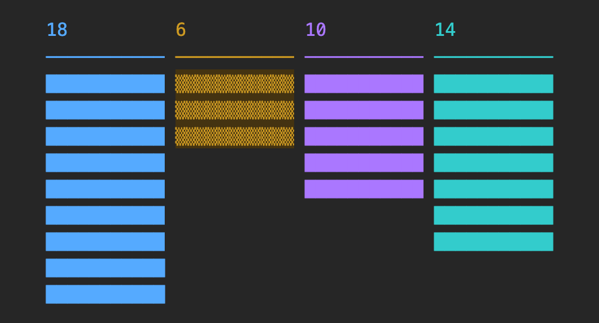

# uhd-kanban: a Markdown Kanban board for Claude Code

[](plugins/uhd-kanban/LICENSE)
[](plugins/uhd-kanban/.claude-plugin/plugin.json)
[](https://github.com/anthropics/claude-code)
[](https://nodejs.org)

English | [한국어](README.ko.md)

**uhd-kanban** is a Claude Code plugin that keeps a per-project Kanban board as plain Markdown files in `kanban/`. The main Claude Code session splits a request into cards, starts one background session (`claude --bg`) per card, and reviews each result. A side pane in Claude Code shows how many cards each column holds and whether each card session is running.

Nothing is installed besides the plugin: no Docker, no server, no database, no npm packages. The board is Markdown and JSON files in a fixed format that `uk check` verifies, and the commands use only Node.js built-in modules.

![The uhd-kanban board monitor pane in Claude Code. A header line reads "02:27 · 9 columns · 502 cards · every 60s", and a legend reads "in-progress: live pending restart resume done none". Below the column counts 261, 28, 6, 160, 22, 4, 11, 6, 4, nine vertical bars, one per column, grow downward; each card is one cell. In the in-progress bar each cell shows its session state: green shaded blocks for running sessions, a yellow braille dot for a session being respawned, a red arrow for a session waiting for a restart, a red hatched cell for a stopped session, a gray check mark for a finished session, and a shaded cell in the column color for a card with no session.](docs/images/board-monitor-502-cards.en.png)

*A sample board with 502 fictional cards in the board monitor pane. The pane shows counts and session states only; card titles are not displayed.*

> [!NOTE]
> Command output, card session prompts and pane labels are available in English and Korean (see [Language](#language)). The skill documents (`SKILL.md`) are written in Korean and include English trigger phrases.

## Contents

- [Why uhd-kanban](#why-uhd-kanban)
- [What is in the plugin](#what-is-in-the-plugin)
- [Quick start](#quick-start)
- [Language](#language)
- [How the board is stored](#how-the-board-is-stored)
- [Delegating work to card sessions](#delegating-work-to-card-sessions)
- [Commands](#commands)
- [Board monitor pane](#board-monitor-pane)
- [Requirements](#requirements)
- [FAQ](#faq)
- [Credits](#credits)
- [License](#license)

## Why uhd-kanban

| Feature | What it does |
|---|---|
| Plain files | One card is one `.md` file. The column is the directory name and the order is the number prefix of the file name, so `ls`, `git diff` and any editor show the board. No Docker, no server, no database, no account, no npm packages: the commands import only Node.js built-in modules (`node:fs`, `node:child_process` and others). |
| Delegation | The main session does not write code. Each card runs in its own `claude --bg` session that receives only the card body as its prompt, so the main session's context does not fill with implementation details. |
| Edit guard | A hook asks the user before the main session edits a project file with Edit, Write or NotebookEdit. The question appears in every permission mode, including `bypassPermissions`. |
| Dependencies and a parallel limit | `depends_on` keeps a card from starting before the cards it waits for are finished. `run.max_parallel` (default 3) caps the number of card sessions that run at once. |
| Recovery | `uk recover` resumes card sessions that stopped or were respawned by the daemon, and records the new session id on the card. |
| Board monitor | A pane draws one cell per card, animates the in-progress cells by session state, and plays a rearrangement when cards are created, deleted or moved. It rereads the board every 60 seconds by default. |

## What is in the plugin

| Component | Path | Purpose |
|---|---|---|
| Skill `uhd-kanban` | [`plugins/uhd-kanban/skills/uhd-kanban/`](plugins/uhd-kanban/skills/uhd-kanban/SKILL.md) | Create, move, reorder, comment on and archive cards. Run a card as a `claude --bg` session. Resume stopped sessions. |
| Skill `delegate` | [`plugins/uhd-kanban/skills/delegate/`](plugins/uhd-kanban/skills/delegate/SKILL.md) | Rules for the main session of a project with a board: split work into cards, run them with `uk run`, review results, move cards. |
| Hooks module | [`plugins/uhd-kanban/hooks/register.tsx`](plugins/uhd-kanban/hooks/register.tsx) | Opens the board monitor pane when `.uhd-kanban/config.json` exists above the session directory, registers the `/kanban-board` command, and runs `uk guard` before Edit, Write and NotebookEdit. |

## Quick start

1. Install the plugin from this repository's marketplace inside Claude Code:

   ```
   /plugin marketplace add hwanyong/skill-kanban
   /plugin install uhd-kanban@skill-kanban
   ```

2. Create a board in the project root. Ask Claude to initialize a uhd-kanban board, or run the command yourself:

   ```sh
   node ~/.claude/plugins/cache/skill-kanban/uhd-kanban/<version>/skills/uhd-kanban/bin/uhd-kanban.mjs init --locale en
   ```

   This creates `.uhd-kanban/config.json`, `.uhd-kanban/profiles.json` and `kanban/`. If they already exist, nothing is changed and the command exits with code 1.

3. Open `claude` once in the project root and accept the workspace trust dialog. `claude --bg` does not inherit trust from parent directories, so `uk run` fails with `Workspace not trusted` until you do.

4. Give the main session a task. With the `delegate` skill, it splits the task into cards, starts them with `uk run`, and reports card ids, results and open decisions back to you.

To install from a local clone instead, run `claude plugin marketplace add <folder>` and then `claude plugin install uhd-kanban@skill-kanban`. Claude Code then reads that folder directly; run `/reload-plugins` after editing it.

## Language

Each board has one language, set by `locale` in `.uhd-kanban/config.json` (`en` or `ko`). It selects the language of command output, of the prompts given to card sessions, and of the board monitor pane. `uk init --locale en|ko` writes it; without `--locale`, `init` takes it from `LC_ALL`, `LC_MESSAGES` or `LANG` at that moment (a value starting with `ko` gives `ko`, anything else `en`). A board without `locale` follows those variables on every run.

Values written into card files do not depend on the language. Statuses, types and comment kinds are English ids such as `progress`, `question` and `result`. A Korean board shows a kind as `progress(진행)`.

Boards created with 0.4.0 or earlier recorded comment kinds as Korean words. `uk check` reports this, and `uk migrate` converts them:

```sh
uk migrate --dry-run   # prints what would change
uk migrate             # rewrites comments.kinds, adds "locale": "ko", and rewrites comment header lines in every card
```

Only the `### c<n> [<kind>]` header lines and two lines of `config.json` change. Running it again changes nothing. `uk comment --kind` and `uk inbox --kind` still accept the 14 old Korean words (`lib/kinds.mjs`) and record the id, so card sessions started before the migration keep working.

## How the board is stored

![Diagram of how uhd-kanban stores a board, drawn from the files of a demo board with 24 cards. Left: the file tree of sample-app. .uhd-kanban/config.json holds the locale, 9 columns and the run, archive and monitor settings; .uhd-kanban/profiles.json maps model: tags to claude --model values. kanban/ holds the column directories 1-to-do (7 cards), 2-in-progress (3), 3-in-review (2), 4-done (8), 5-decided (1), 7-implemented (1), 8-cancelled (1) and 9-active (1). 6-planned/ is absent because a column directory exists only while it holds cards. Top right: the path kanban/2-in-progress/0040-k2-Add-login-form-validation.md split into the column directory 2-in-progress (status in-progress), the order in the column 0040, the card id k2 and the title Add-login-form-validation. Bottom right: the 28 lines of that file. Lines 1 to 12 are YAML frontmatter (id, type, title, priority, tags, depends_on, created_at, updated_at, session, session_started_at), which only uk commands change, together with the file name and directory, while holding the .uhd-kanban/lock/ directory. Line 14 is the body, which uk run puts in the prompt of the card session. Lines 16 to 28 are ## Comments with three blocks: c1 [assign] written by uk run, c2 [question] written by the card session, and c3 [assign] written by uk recover.](docs/images/board-storage.en.png)

*Generated from the files of a demo board. The tree and the file content are the files on disk; lines longer than the view end in …*

| Path | Content |
|---|---|
| `.uhd-kanban/config.json` | Columns, the initial column per card type, order numbering, dependency rules, comment kinds, archive rules, `run` settings and `monitor` settings |
| `.uhd-kanban/profiles.json` | Maps `model:` tag profiles to `claude --model` values |
| `kanban/<n>-<status>/<order>-k<id>-<title>.md` | A card in a column, for example `kanban/1-to-do/0010-k457-fix-login-error.md` |
| `kanban/archived/<YYYY-MM>/<YYYY-MM-DD>-k<id>-<title>.md` | An archived card. The date is the date of `completed_at`. |

A card is YAML frontmatter, a body, and a `## Comments` section. `uk run` uses the body as the prompt of the card session.

```markdown
---
id: 457
type: task
title: Fix login error
priority: high
tags: [model:deep, effort:high]
depends_on: [455]
created_at: 2026-10-29T08:00:00Z
updated_at: 2026-10-29T09:10:00Z
---

Goal, files to change, what not to do, and how to verify the result.

## Comments

### c1 [assign] from=user to=k457 at=2026-10-29T09:00:00Z

Started with claude --bg. session=… model=opus(model:deep) effort=high
```

Frontmatter, file names and directories are changed only through commands. The commands take a lock (the `.uhd-kanban/lock/` directory) and update the file name and the frontmatter together. After editing a card body by hand, run `uk check`.

### What `uk check` verifies

The format is fixed, so `uk check` alone verifies every card file. Commands that change the board run the same check first and change nothing while a rule is broken.

| Target | Rule |
|---|---|
| File name | `<order>-k<id>-<title>.md`. The order number has `order.width` digits (default 4) and appears once per column |
| File name and frontmatter | `id` equals the `k<id>` of the file name, and the title part equals `title` |
| Directory | Every directory and file under `kanban/` is a column in `columns` of `config.json` or `archive.dir` (default `archived/`) |
| Column and `type` | The card `type` is in `types` of its column |
| Card id | One card id appears in one place on the board |
| Frontmatter values | `priority` is a known value, `tags` is a list of strings, `depends_on` is a list of card ids |
| Comments | Each `### c<n> [kind]` kind is in `comments.kinds` of `config.json` |

### Default columns

| Directory | `status` | Card types it accepts | Meaning |
|---|---|---|---|
| `1-to-do` | `to-do` | task, bug, decision | Not started |
| `2-in-progress` | `in-progress` | task, bug, decision | A card session is working on it |
| `3-in-review` | `in-review` | task, bug | Implemented, waiting for review |
| `4-done` | `done` | task, bug, decision, milestone | Finished |
| `5-decided` | `decided` | decision | Decided, not yet applied |
| `6-planned` | `planned` | milestone | Planned milestone |
| `7-implemented` | `implemented` | decision | Decision applied to the code |
| `8-cancelled` | `cancelled` | task, bug, decision | Will not be done |
| `9-active` | `active` | milestone | Milestone in progress |

| Card type | Column order |
|---|---|
| task, bug | `to-do` → `in-progress` → `in-review` → `done`, or `cancelled` |
| decision | `to-do` → `in-progress` → `decided` → `implemented`, or `done` when no code change is needed, or `cancelled` |
| milestone | `planned` → `active` → `done` |

## Delegating work to card sessions

`uk run k457` does four things:

1. Converts the card's `model:<profile>` tag to `--model` through `profiles.json`, and passes an `effort:<value>` tag as `--effort`.
2. Moves the card to the `run.status` column (`in-progress`) after the same dependency check as `uk move`.
3. Runs `claude --bg --dangerously-skip-permissions -n k457 --model … <prompt>` in the project root. The prompt is the card body plus instructions for leaving `progress`, `question` and `result` comments and for moving the card after the result.
4. Writes `session` and `session_started_at` to the card and adds an `assign` comment.

Card sessions run without permission prompts because nobody is present to answer them. They all share the project's working tree, so cards that change the same files, generated files or devices must be ordered with `depends_on`.

| Tag | `--model` |
|---|---|
| `model:top` | `fable` |
| `model:deep-1m` | `opus[1m]` |
| `model:deep` | `opus` |
| `model:standard` | `sonnet` |
| `model:fast` | `haiku` |
| `model:user` | none. The card is for a person and `uk run` does not start it. |

Card sessions report back through comments. `uk comment` appends a comment and prints a `SendMessage` line for the recipient session, and `uk inbox` lists comments addressed to a session that have not been answered.

## Commands

In the skill documents, `uk` stands for `node <skill folder>/bin/uhd-kanban.mjs`. You usually do not type these commands; Claude runs them through the skills. Cards are referred to as `k457` or `457`.

| Command | What it does |
|---|---|
| `uk init` | Creates `.uhd-kanban/` and `kanban/`. `--locale en\|ko` sets the board language |
| `uk check` | Validates the configuration and every card without changing files |
| `uk new` | Creates a card |
| `uk move` | Moves a card to another column, with dependency checks |
| `uk order` | Changes a card's position within its column |
| `uk renumber` | Renumbers the order prefixes of one column |
| `uk set` | Changes title, priority, tags, `depends_on` or `collection` |
| `uk archive` | Moves finished cards older than `archive.after_days` (default 7) to `kanban/archived/` |
| `uk comment` | Appends a comment and prints the `SendMessage` line |
| `uk inbox` | Lists unanswered comments addressed to a session |
| `uk run` | Starts a card as a `claude --bg` session |
| `uk recover` | Resumes stopped card sessions with `claude --bg --resume` |
| `uk guard` | Decides whether a session may edit a file (used by the hook) |
| `uk board` | Prints card counts per column and session states (used by the pane) |
| `uk migrate` | Converts a board made with 0.4.0 or earlier to English kind ids and adds `locale` |
| `uk locale` | Prints the language used in the current directory (used by the pane) |

Exit codes: `0` success, `1` rule violation or failure (details on stderr), `2` usage error, `3` no board above the current directory. Full options are in [`SKILL.md`](plugins/uhd-kanban/skills/uhd-kanban/SKILL.md#명령).

Example output of `uk board` for the demo board below (`locale` `en`):

```
1-to-do 7
2-in-progress 3 (sessions: live 2 · none 1)
3-in-review 2
4-done 8
5-decided 1
6-planned 0
7-implemented 1
8-cancelled 1
9-active 1
```

## Board monitor pane


*A demo board with 24 fictional cards and one in-progress card in each session state.*

The pane opens when the session directory has `.uhd-kanban/config.json` above it. The counts row at the top lists the number of cards per column in the order of `config.json` `columns`, and each bar grows downward with one cell per card. If a pane was closed, `/kanban-board` opens it again.

| Cell in the in-progress column | Legend label | Session state | Repaint interval |
|---|---|---|---|
| Green `░▒▓█▓▒`, one character apart per card | `live` | Running | 250 ms |
| Yellow `⠋⠙⠸⠴⠦⠇` | `pending` | Being respawned by the daemon | 250 ms |
| Red `↻`, text and background colors swap every frame | `restart` | The respawned session is idle and the last turn is the user's. `uk recover` stops and resumes it | 250 ms |
| Red `▨` | `resume` | Stopped. `uk recover` resumes it | - |
| Gray `✓` | `done` | Finished | - |
| `▒` in the column color | `none` | The card has no session | - |

The refresh interval is `monitor.interval_seconds` in `config.json` (an integer of 10 or more, default 60).

`monitor.cell` in `config.json` sets how much of a bar one card takes. In every mode the bar width is the pane width divided by the number of columns, so the bars change when the pane is widened or narrowed. When a count is wider than its bar, the counts that would touch are written on more lines.

| `monitor.cell` | One card is | Cards per row | Board with few cards | Board with hundreds of cards |
|---|---|---|---|---|
| `char` (default, also when the key is absent) | One character | The bar width | A bar fills its first row only when its column has as many cards as the bar width | One character per card, so long bars take the fewest rows |
| `row` | One row of the bar | 1 | Each card fills the bar width | One card per row, so long bars need more scrolling |
| `fit` | The bar width divided among the cards of a row | As many as the longest bar needs to fit the pane height, up to the bar width | Same as `row` | A full row fills the bar width. When the bar width does not divide evenly, some cells are one character wider |

A bar that does not fit the pane height scrolls in every mode.

### Rearrangement


*One card deleted, one created and one moved from in-progress to in-review, captured from a pane every 100 ms.*

When a read of `uk board --json` finds that cards were created, deleted or moved, the pane plays one rearrangement before it shows the new board. Frames are 100 ms apart and a rearrangement takes at most 31 frames (3.1 seconds).

| Step | Frames | What is drawn |
|---|---|---|
| Fade out | 0 or 8 | The cell of a deleted card changes through `▓▒░⠿⠶⠒⠂` while its color moves toward gray, then becomes blank. The count above the bar drops at the end of this step |
| Close | 0–8 | Cards behind the blank move forward, the nearest first. With more than 8 cards to move, several move in one frame |
| Open | 0–8 | Cards behind the place of a new card move back, the farthest first |
| Fade in | 0 or 7 | The new card goes through the same characters in reverse. The count above the bar rises at the start of this step |

- A moved card is a deletion in the old column and a creation in the new one. A card that only changes its place inside a column is played the same way.
- A card whose session state alone changed is redrawn with no rearrangement.
- The first read after the session starts plays nothing. A change is seen at the next read, so it can be up to `monitor.interval_seconds` late.
- A change that arrives during a rearrangement starts a new one from the final state of the one that was playing.

### Animation examples

Each image is an APNG (animated PNG, a PNG file with several frames that browsers play) of the counts row and the bars on a fictional board with the columns `to-do`, `in-progress`, `in-review` and `done`. The frames were captured every 50 ms from the pane of a Claude Code session in a tmux window. The session state examples repeat one cycle. The other examples hold the first frame for 1 second and the last frame for 1.5 seconds, and their `in-progress` cards have no session, so only the rearrangement changes.

#### `live`

8 `in-progress` cards. A cycle is 6 frames of 250 ms.


#### `pending`

8 `in-progress` cards. A cycle is 6 frames of 250 ms.


#### `restart`

8 `in-progress` cards. A cycle is 2 frames of 250 ms.


#### All 6 session states

12 `in-progress` cards, 2 per state. `live`, `pending` and `restart` change. `resume`, `done` and `none` stay fixed.


#### Delete

The 6th `to-do` card is deleted. The count goes from 14 to 13.


#### Create

A card is created in the 6th `to-do` place. The count goes from 14 to 15.


#### Move between columns

The 4th `to-do` card moves to the 2nd `in-progress` place.


#### Reorder in a column

The last `to-do` card moves to the 1st place.


#### Delete in a long bar

The 3rd of 60 `to-do` cards is deleted. 57 cards move forward in 8 frames, so several move in one frame.


#### Delete with `row`

`monitor.cell` is `row`. The 2nd of 6 `to-do` cards is deleted.



#### Delete with `fit`

`monitor.cell` is `fit` and the pane height allows 2 cards per row. The 4th of 18 `to-do` cards is deleted.



### When the pane animates

`Raster` is the Claude Code element that draws a grid of cells and repaints it without running the render hook (`$.ui.blit`). It exists only on the terminal surface.

| Situation | Drawn with | Timer |
|---|---|---|
| Terminal, grid of at most 512 columns and 256 rows | `Raster` | 100 ms during a rearrangement, 250 ms while a `live`, `pending` or `restart` card exists, otherwise none |
| Terminal, larger grid (a long bar with `monitor.cell` set to `row`) | `Text`, fixed at the first frame | None |
| Desktop, VS Code and mobile surfaces | `Text`, fixed at the first frame | None |
| Pane behind another tab | Not repainted | Checks every second whether the pane is shown again |
| Pane closed | - | None |

The desktop, VS Code and mobile rows were checked on the element tree with `claude plugin test`, not in those apps. Colors are fixed RGB values, so the dark cell backgrounds stay dark on the light theme.

Measured on a Mac Studio (`Mac17,14`) with Claude Code 2.1.312 in a 200×50 tmux window and a board of 511 cards. CPU is the growth of `ps -o cputime=` divided by the measured time, and output is the bytes `tmux pipe-pane` received. The CPU of the terminal app itself is not included.

| State | Measured for | `claude` process CPU | Output to the terminal |
|---|---|---|---|
| Timer off | 30 s | 0.70% | 0 B/s |
| 250 ms repaint | 30 s, two runs | 1.90%, 1.53% | 1945 B/s, 1954 B/s |
| A rearrangement every 3.4 s, with test `board` output set to a 1-second interval (the `config.json` minimum is 10) | 28 s | 3.79% | 2303 B/s |

In a 15-minute run of two sessions side by side, the session repainting every 250 ms used 1.59% CPU and its RSS (resident memory) went from 468 MB to 504 MB. The session with the timer off used 0.35% CPU and its RSS went from 463 MB to 478 MB. Runs longer than 15 minutes were not measured.

## Requirements

- Claude Code 2.1.312 or later (the hooks module API was checked against this version)
- Node.js 21 or later on `PATH` (`Object.groupBy`)
- Nothing else to install: no Docker, no database, no npm packages. `git` is used only when the project is a git repository (cards tracked by git move with `git mv`).
- Developed on macOS. Other platforms have not been verified.

## FAQ

### What is uhd-kanban?

A Claude Code plugin that stores a Kanban board as Markdown files inside the project and lets the main Claude Code session hand each card to its own background session. It contains two skills (`uhd-kanban` and `delegate`) and a hooks module that draws the board monitor pane.

### Does it need Docker, a server, a database or an account?

No. The board is the `kanban/` directory and `.uhd-kanban/` configuration. Commands are a Node.js script that reads and writes these files and imports only Node.js built-in modules, so there is no `npm install` and no container.

### How is it different from a hosted issue tracker?

The board is part of the repository, so cards are versioned with the code and Claude sessions read and write them with file commands. A hosted tracker keeps cards outside the repository and needs an API and an account.

### How many card sessions can run at the same time?

Three by default. Set `run.max_parallel` in `.uhd-kanban/config.json` to another positive integer, or to `-1` for no limit. `uk run` refuses to start a card when the limit is reached and exits with code 1.

### Can I edit cards by hand?

You can edit the card body (the part before `## Comments`) and then run `uk check`. Change frontmatter, file names and columns with `uk new`, `uk set`, `uk move` and `uk order`, and add comments with `uk comment`.

### What happens when a card session stops?

`uk board` and the pane show it as stopped. `uk recover` resumes it with `claude --bg --resume`, writes the new session id to the card, and adds an `assign` comment. A card that came back from review is resumed with `uk recover --force k<id>`.

### Does it work with git worktrees?

Yes. When a command runs inside a git worktree, it uses the board of the main worktree, so card ids and order numbers stay in one place.

### Can the main session still edit files when I ask it to?

Yes. The edit guard asks instead of refusing. Approve the confirmation prompt for that request.

## Credits

Written from scratch in Node.js ESM with reference to [mattjoyce/kanban-skill](https://github.com/mattjoyce/kanban-skill) (commit b86a6ec, Apache-2.0).

## License

[MIT](plugins/uhd-kanban/LICENSE)
